<div align="center">

# LANDFALL

### EVERY RELIEF PAYMENT DESERVES AN ANSWER.

Relief payments for community funds, followed all the way from the storm warning to the household's own answer: *did the money arrive?*

[](https://github.com/Bharathadi01/landfall/actions/workflows/ci.yml)
[](LICENSE)


**[Live demonstration](https://landfall-web-t5rw.onrender.com)** · **[Judge test card](https://landfall-web-t5rw.onrender.com/judges)** · **[Source](https://github.com/Bharathadi01/landfall)** · **[Documentation](docs/README.md)**

Built for the PayPal AI Hackathon 2026.

[](https://www.youtube.com/watch?v=HJbbtvwYJsc)

### [▶ WATCH THE FULL DEMONSTRATION](https://www.youtube.com/watch?v=HJbbtvwYJsc)

</div>

> **Status, honestly.** Landfall is a hackathon-stage prototype. It runs against the **PayPal Sandbox** (play money) with **synthetic households** and a **historical replay** of Hurricane Milton (2024). No real donation has been taken, no real family has been paid, and no humanitarian outcome is claimed. It is **not ready for real funds or real beneficiaries**: operator sign-in is a one-click demonstration persona, among other gaps listed in [SECURITY.md](SECURITY.md) and [docs/LIMITATIONS.md](docs/LIMITATIONS.md).

## See Landfall in Action

[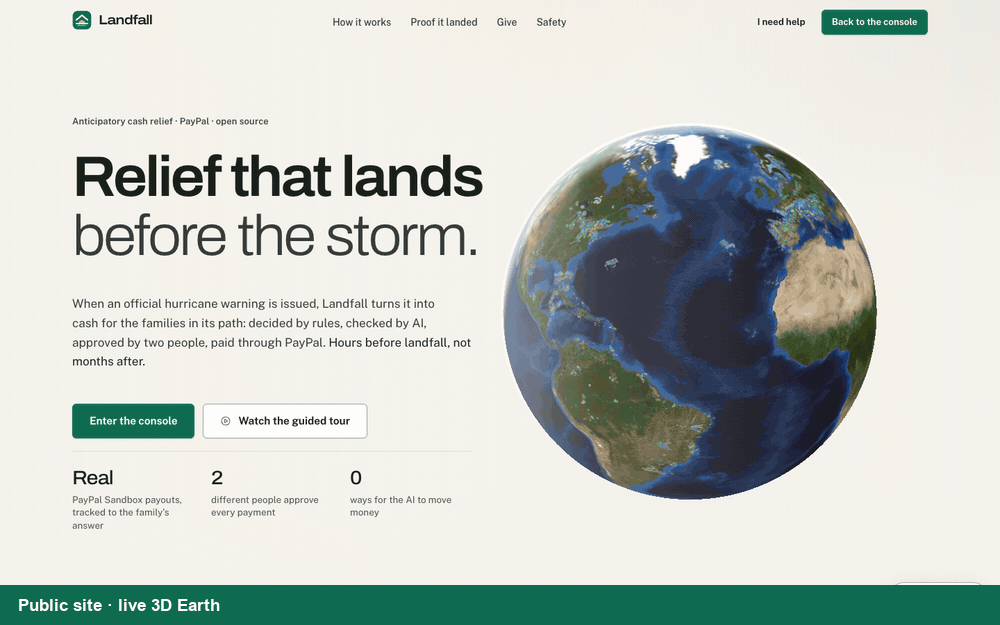](https://www.youtube.com/watch?v=HJbbtvwYJsc)

*Eight real screens of the deployed application, cross-faded, with a caption strip added. Click for the full video.*

| | |
|---|---|
| [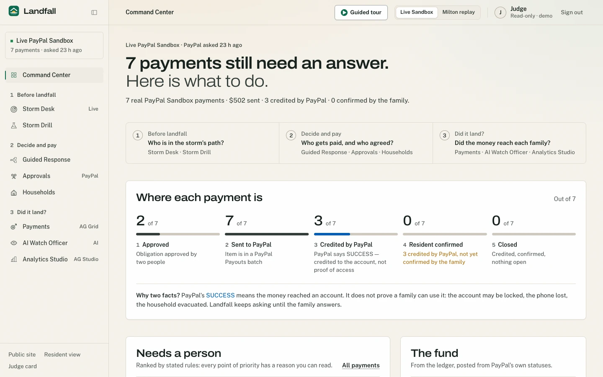](docs/PRODUCT_OVERVIEW.md#b-command-center)<br>**Command Center**: what needs a person now | [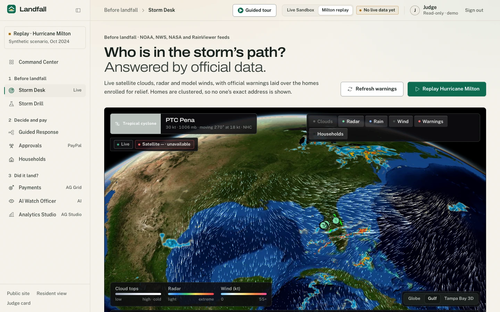](docs/PRODUCT_OVERVIEW.md#c-sentinel-storm-atlas-storm-desk)<br>**Storm Desk**: official warnings over enrolled homes *(local build, see note)* |
| [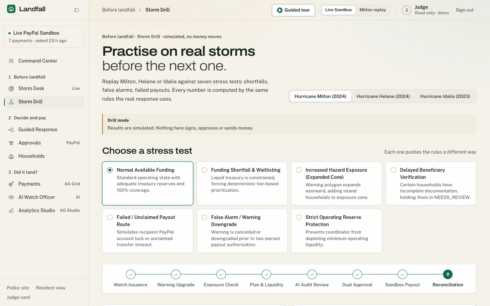](docs/PRODUCT_OVERVIEW.md#d-storm-drill)<br>**Storm Drill**: rehearse on past hurricanes (simulation) | [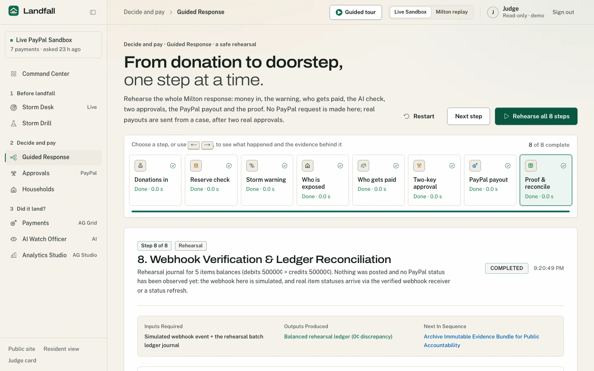](docs/PRODUCT_OVERVIEW.md#guided-response)<br>**Guided Response**: warning to payout, eight steps (simulated PayPal) |
| [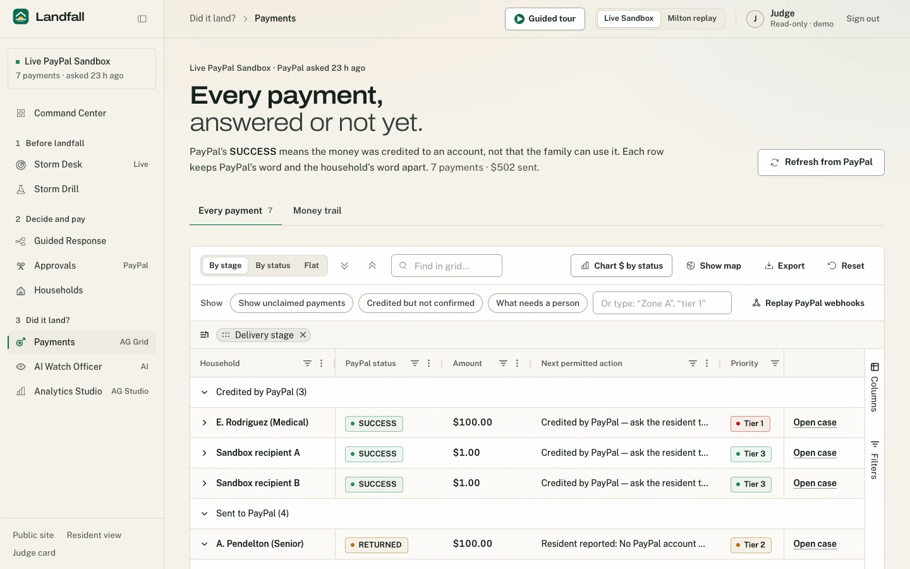](docs/PRODUCT_OVERVIEW.md#g-paypal-integration)<br>**Payments**: PayPal status in AG Grid | [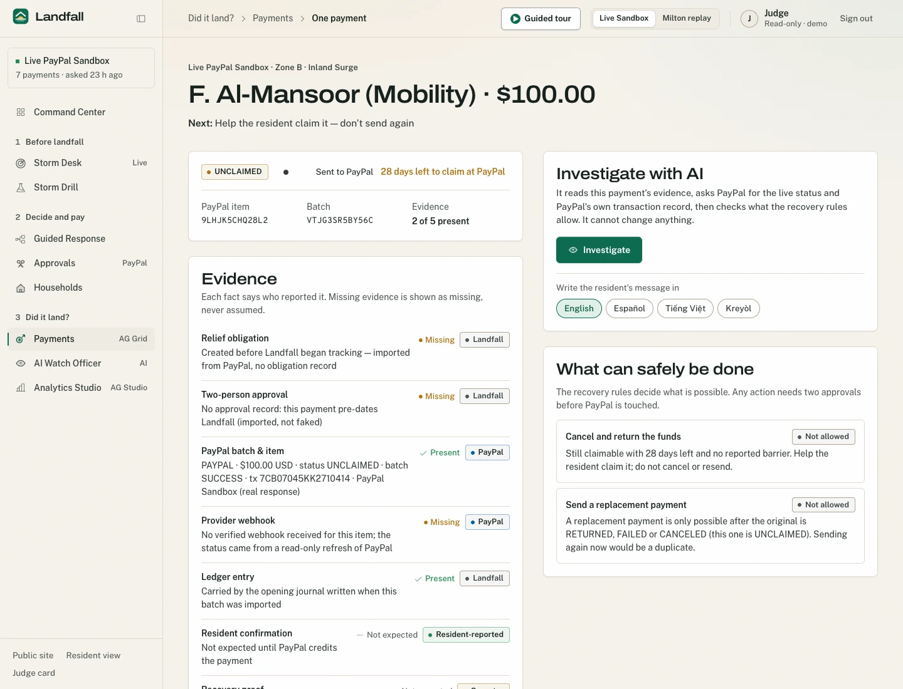](docs/PRODUCT_OVERVIEW.md#j-ai-case-officer)<br>**Case page**: evidence behind one payment |
| [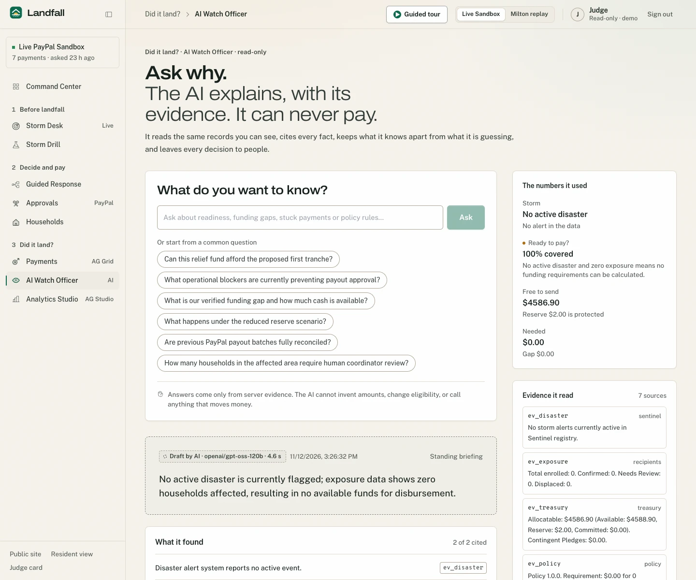](docs/PRODUCT_OVERVIEW.md#i-ai-watch-officer)<br>**AI Watch Officer**: cited, read-only | [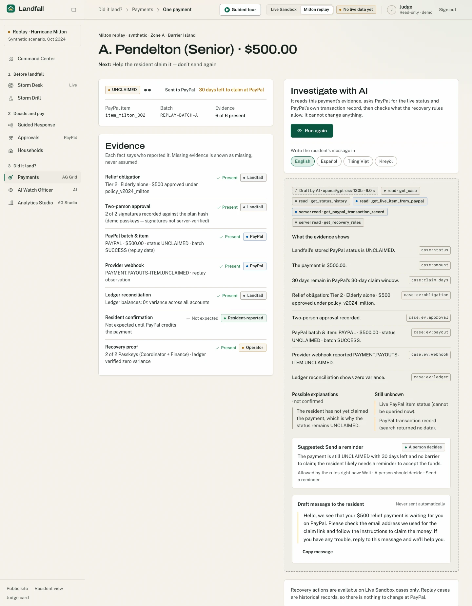](docs/PRODUCT_OVERVIEW.md#j-ai-case-officer)<br>**AI Case Officer** on a *Milton replay* case *(local build)* |
| [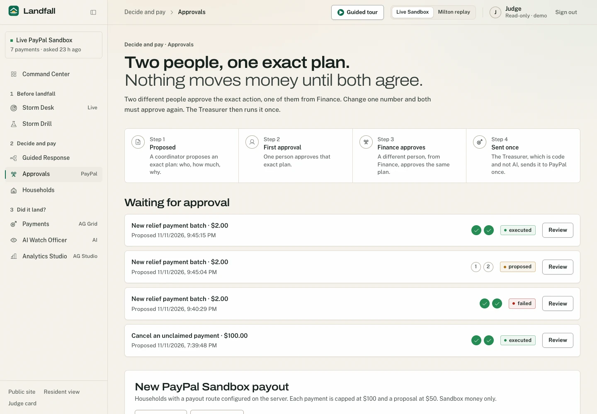](docs/PRODUCT_OVERVIEW.md#l-governance-and-security)<br>**Approvals**: two different people | [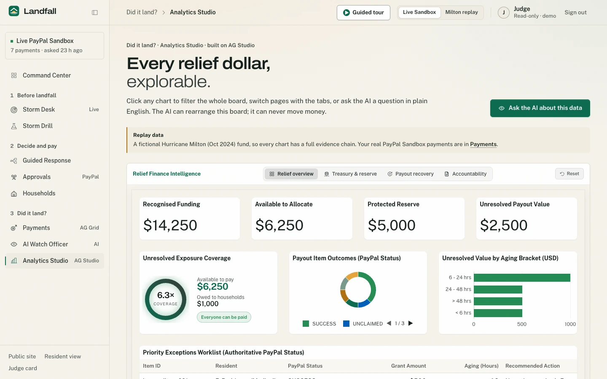](docs/PRODUCT_OVERVIEW.md#k-ag-grid-ag-charts-and-ag-studio)<br>**Analytics Studio** (AG Studio, synthetic data) |
| [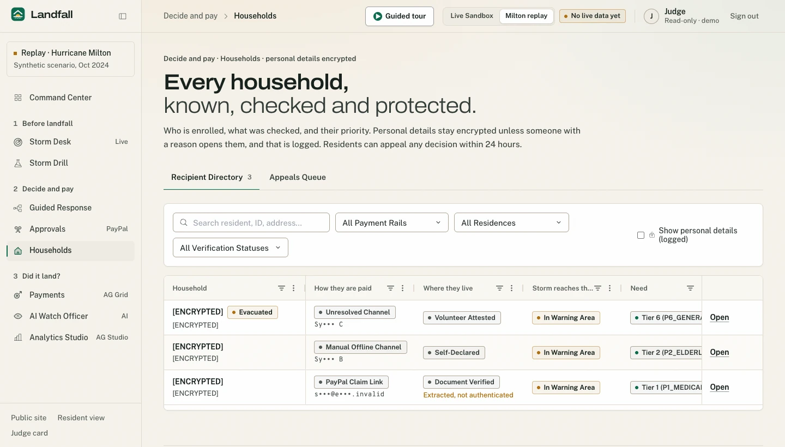](docs/PRODUCT_OVERVIEW.md#e-recipient-system-households)<br>**Households** *(three synthetic households, local build)* | [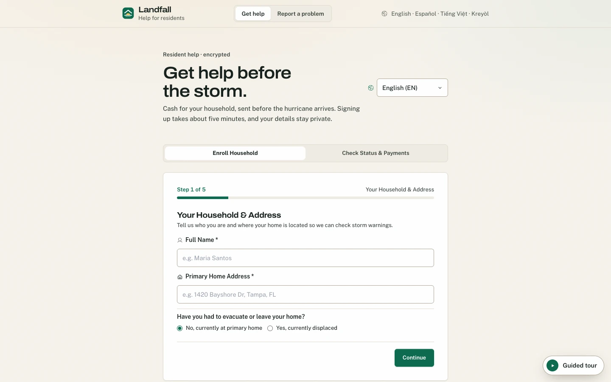](docs/PRODUCT_OVERVIEW.md#m-resident-portal)<br>**Resident portal**: status in plain language |
| [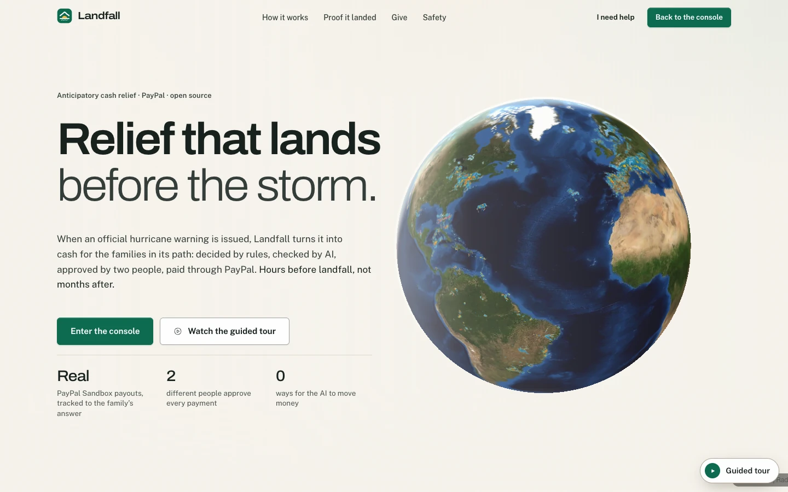](docs/PRODUCT_OVERVIEW.md#a-public-site)<br>**Public site** | [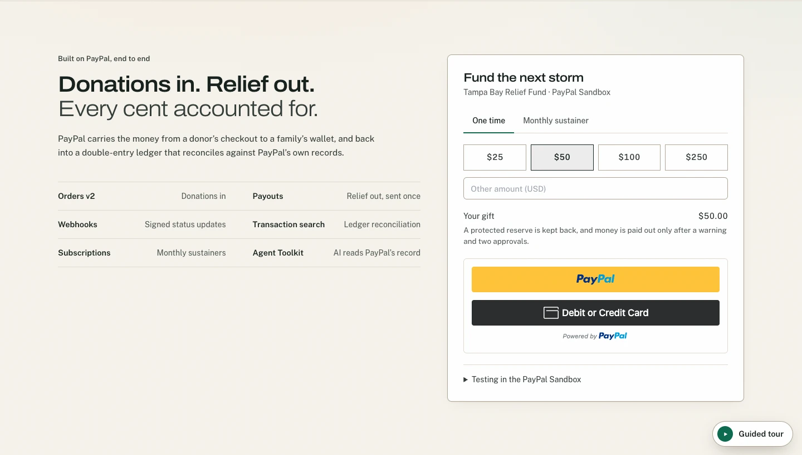](docs/PRODUCT_OVERVIEW.md#a-public-site)<br>**Giving** through PayPal Smart Buttons (Sandbox) |

*Note: 11 images are captures of the production deployment. Three could not be captured faithfully there and come from a local build of the same commit: Households (three obviously synthetic households in a disposable database), the AI Case Officer (a replay case), and the Storm Desk (production's NASA satellite and Open-Meteo wind layers were unavailable at capture time and still were when re-checked on 2026-11-12; the local capture has wind but **still shows the app's own red "Satellite — unavailable" label**, which is the app honestly reporting a real upstream failure). Details: [docs/DATA_PROVENANCE.md](docs/DATA_PROVENANCE.md#5-what-was-verified-for-this-documentation).*

## The problem

A community relief fund can send money to storm-hit families in hours. Then the hard question begins: **did it arrive?** A payment passes through six different facts that most tools collapse into one green tick:

| # | Stage | Meaning | Who says so |
|---|---|---|---|
| 1 | Payment **initiated** | The fund decided to pay and two people agreed | Landfall |
| 2 | Payment **submitted** | The instruction was sent to PayPal | Landfall |
| 3 | Payment **succeeded** | PayPal says it credited the recipient's PayPal account | PayPal |
| 4 | Payment **claimed** | A recipient with no PayPal account has signed up and taken it (otherwise it stays *unclaimed* and PayPal returns it after 30 days) | PayPal |
| 5 | Recipient **confirmed** | The household says it received the money and can use it | The household |
| 6 | Reconciliation **completed** | The ledger and PayPal's own balance agree, with any difference explained | Landfall, from both sides |

Evidence from the project's own Sandbox run: PayPal reported a $500 batch as `SUCCESS` while **one of five** payments had been credited and three were still unclaimed (owner-provided evidence, [docs/PAYPAL_INTEGRATION.md](docs/PAYPAL_INTEGRATION.md#8-evidence-register-owner-provided-not-re-executed)). "Batch succeeded" did not mean "everyone was paid." Landfall keeps the stages apart so every payment ends in an answer: *delivered, confirmed, returned, or needs a person*.

## What Landfall does

Full tour with screenshots: [docs/PRODUCT_OVERVIEW.md](docs/PRODUCT_OVERVIEW.md). The sidebar follows the life of a payment.

| Stage | Screens | What it does |
|---|---|---|
| Home | **Command Center** | "Every payment has an answer", or a count of the ones that don't, each with a next action |
| Before landfall | **Storm Desk** · **Storm Drill** | Live official warnings (NWS, NHC, NASA GIBS, RainViewer, Open-Meteo) on a WebGL globe, with exposure decided by point-in-polygon; rehearse a response on past hurricanes |
| Decide and pay | **Guided Response** · **Approvals** · **Households** | A simulated eight-step walk from warning to payout; a two-person approval that is the only way money moves; enrolment with unbundled consent |
| Did it land? | **Payments** · **AI Watch Officer** · **Analytics Studio** | Every PayPal payment past `SUCCESS` to the household's own answer in AG Grid; AI that explains with cited evidence and never pays; AG Studio over the relief data |
| Residents | **Resident portal** | Plain-language status in five languages; "I received it" / "I can't access it"; appeals and complaints |

### Try it in two minutes (no setup)

1. Open the **[live demonstration](https://landfall-web-t5rw.onrender.com)** (the free server sleeps when idle; the first request can take about 30 seconds).
2. Press **Watch the guided tour**: it signs you in read-only and walks every screen in order. It cannot pay, approve, refresh PayPal or change data; Esc exits.
3. Or open the **[judge test card](https://landfall-web-t5rw.onrender.com/judges)** for demo personas, resident codes, the Sandbox test card and the demo approval PIN.

## How it works

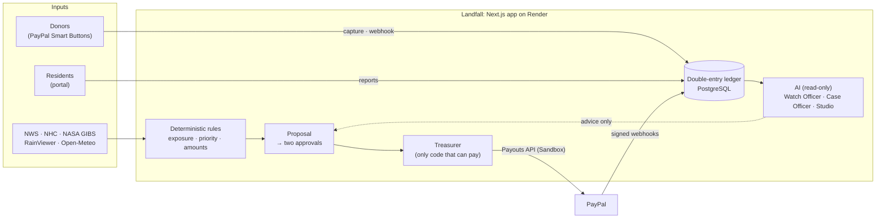

Four rules shape everything ([docs/ARCHITECTURE.md](docs/ARCHITECTURE.md)):

1. **Rules decide the money.** Who is exposed, who is prioritised and how much are computed by code, not by AI.
2. **Two different people approve**, one of them Finance, and only the Treasurer can call PayPal's write APIs (an architecture test enforces the boundary).
3. **PayPal's word is recorded, in order.** Status events are verified, idempotent and can never move a payment backwards; the ledger is double-entry and replay-safe.
4. **AI cannot independently authorise or move money.** It has read-only tools, every figure it states is checked against the ledger, and when it is unavailable the app says so ([docs/AI_ARCHITECTURE.md](docs/AI_ARCHITECTURE.md)).

## PayPal integration

All of it runs on the **PayPal Sandbox**. Detail, status mapping and idempotency: [docs/PAYPAL_INTEGRATION.md](docs/PAYPAL_INTEGRATION.md).

| Capability | Used for | State |
|---|---|---|
| Orders v2 + Smart Buttons | One-time donations | Working; renders on the site |
| Subscriptions | $25 monthly sustainer | Working; activation re-checked with PayPal |
| **Payouts v1** | Relief payments; cancelling an unclaimed one | Working; Treasurer-only; Sandbox batches recorded by the owner |
| **Webhooks** | Authoritative status, 18 event types | Signature verified through PayPal; idempotent |
| Reporting | Reconciliation against PayPal's balance | Working (reporting lags) |
| **Agent Toolkit** | The Case Officer reads PayPal's own transaction record | Read-only (`list_transactions` only) |
| Vault | Contingent "storm pledges" | **Partly built, not operational**: nothing charges a pledge; Sandbox refuses the setup call |
| Log in with PayPal | Identity check | Prototype; result is not persisted |

## AI

Three features, all read-only ([docs/AI_ARCHITECTURE.md](docs/AI_ARCHITECTURE.md)): the **Watch Officer** (seven evidence tools; readiness and figures are *overridden* by the ledger), the **Case Officer** (five tools incl. PayPal's own record; every fact must cite evidence or it is dropped; its recommendation is clamped to what the recovery rules allow) and the **AG Studio agent** (AG Studio's agent framework with a Landfall model adapter). Models run on Groq (`gpt-oss-120b` / `gpt-oss-20b`; Prompt Guard 2 and a policy model screen inputs). A labelled deterministic fallback answers when a model is unavailable. A 60-prompt screening eval, written and run by the project, blocked 29 of 30 attacks with no false positives ([docs/AI_EVAL_RESULTS.md](docs/AI_EVAL_RESULTS.md), not independent). No evaluation of answer quality exists.

## AG Grid, AG Charts and AG Studio

AG Grid Enterprise powers **Payments** and **Households**: set filters, row grouping with a group panel, aggregation, master/detail, integrated charts, cell selection, custom context menu and renderers. AG Charts draws the fund donut. AG Studio 3.1.0 powers **Analytics Studio** over synthetic replay data, with a custom Solvency widget and an agent that can rearrange the board but not the money. The repository contains no licence keys; supply them as environment variables ([`.env.example`](.env.example)). Without a valid key AG's own evaluation notice stays visible.

## Security and governance

Controls that exist: default-deny API with one access table (tested), signed cookie sessions, cross-site write blocking, two-person approval bound to the exact payload (passkeys, or a labelled demo PIN in Sandbox), PayPal-verified webhooks, idempotent money handling, redacted audit logs, resident code lockout. **Known gaps are listed, not hidden:** no production authentication, a public demo PIN, a source-code fallback encryption key when none is configured, in-memory rate limits, and a few public routes without ownership checks. Read [SECURITY.md](SECURITY.md) and [docs/THREAT_MODEL.md](docs/THREAT_MODEL.md) before reusing any of this.

## Technology

Only what the code uses (checked against imports): **Next.js 15** (App Router) · **React 19** · **TypeScript** (strict) · **Tailwind CSS 3** · **GSAP** (motion) · **MapLibre GL** with custom WebGL layers · **Turf.js** · **PostgreSQL 16** with **Drizzle ORM** · **Zod** · **Groq SDK** · **@paypal/agent-toolkit** and PayPal's REST APIs through a small typed client · **@simplewebauthn** · **AG Grid Enterprise 36**, **AG Charts 14**, **AG Studio 3.1** · **Phosphor icons** · **Vitest** · **Playwright** (audit and capture scripts) · **Docker** (local and CI database) · **GitHub Actions** · **Render**.

## Repository map

```text
app/                    Next.js routes
  page.tsx              public landing page (globe, giving, guided-tour button)
  console/              the operator console: war-room (Command Center), sentinel (Storm Desk), rehearsal (Storm Drill),
                        golden-flow (Guided Response), proposals (Approvals), recipients (Households), payments,
                        watch-officer, studio, cases/[ref]
  r/                    resident pages: enroll (+ status), complaints
  judges/, signin/, validate/
  api/                  49 route files / 63 method-route pairs (docs/API.md)
components/             UI: layout (flow.ts drives navigation), grid, studio, sentinel (Storm Desk), tour, donate, ui, icons…
lib/
  treasurer/            the ONLY code allowed to call PayPal write APIs
  proposals/            propose → approve → execute
  ledger/  payouts/  treasury/   double-entry ledger, durable payout records and status handling, reconciliation
  paypal/               typed PayPal client and APIs (orders, payouts, subscriptions, reporting, vault, identity, toolkit)
  ai/                   groq gateway, safety (input screening), watch-officer, case-officer, studio adapter
  rules/  recovery/     deterministic rules engine and recovery decision rules
  sentinel/  geo/       weather ingestion, replay, exposure (point-in-polygon)
  security/  auth/      WebAuthn, encryption, rate limiting, sessions, access policy
  relief/  studio/  fixtures/   case model; synthetic/replay datasets
  db/                   Drizzle schema (44 tables) and audit helpers
tests/                  79 files, 735 tests (docs/TESTING.md)
docs/                   current documentation (docs/README.md) plus older milestone reports
evals/  scripts/        the 60-prompt screening eval; operational, capture and audit scripts
render.yaml  .github/workflows/ci.yml  .env.example
```

## Run it yourself

```bash
git clone https://github.com/Bharathadi01/landfall.git && cd landfall
pnpm install
docker run -d --name landfall-dev-pg -e POSTGRES_PASSWORD=postgres -e POSTGRES_DB=landfall -p 5432:5432 postgres:16-alpine
cp .env.example .env.local            # set PAYPAL_CLIENT_ID / NEXT_PUBLIC_PAYPAL_CLIENT_ID (Sandbox) and SESSION_SECRET
pnpm db:push --force                  # create the tables (no migrations exist)
pnpm dev                              # http://localhost:3000, sign in at /signin
```

Environment variables are documented in [`.env.example`](.env.example); setup, scripts and what is unsafe to run are in [docs/DEVELOPMENT.md](docs/DEVELOPMENT.md); deployment in [docs/DEPLOYMENT.md](docs/DEPLOYMENT.md).

### Tests

```bash
pnpm exec tsc --noEmit && pnpm lint && pnpm test
```

On 2026-11-12 (type-check, lint, build and the full suite on a disposable database): **79 test files, 735 tests passing**, lint clean, build succeeded; coverage 85 % statements overall, 100 % on `lib/rules` and `lib/treasurer` ([docs/TESTING.md](docs/TESTING.md) has the output and, more importantly, **what is not tested**: no browser tests in CI, no live PayPal or model calls in the suite).

## Limitations

The short version: Sandbox only; synthetic and replay data; demonstration sign-in; pledges, email delivery, voice reporting and identity linking are incomplete; some tables, AI modules and widgets exist but are not wired in; no migrations, backups or independent review. The complete, verified list is [docs/LIMITATIONS.md](docs/LIMITATIONS.md); what it would take to go further is [docs/ROADMAP.md](docs/ROADMAP.md) (proposals, not promises).

## Documentation

[docs/README.md](docs/README.md) is the index: [product overview](docs/PRODUCT_OVERVIEW.md), [user journeys](docs/USER_JOURNEYS.md), [architecture](docs/ARCHITECTURE.md), [financial ledger](docs/FINANCIAL_LEDGER.md), [PayPal integration](docs/PAYPAL_INTEGRATION.md), [AI architecture](docs/AI_ARCHITECTURE.md), [data model](docs/DATA_MODEL.md), [API](docs/API.md), [threat model](docs/THREAT_MODEL.md), [data provenance](docs/DATA_PROVENANCE.md), [testing](docs/TESTING.md).

## Contributing and licence

See [CONTRIBUTING.md](CONTRIBUTING.md) and report vulnerabilities as described in [SECURITY.md](SECURITY.md). Released under the [MIT licence](LICENSE), © 2026 Bharath Adithya. Third-party data (NWS, NHC, NASA GIBS, RainViewer, Open-Meteo, OpenFreeMap/OpenStreetMap, Esri imagery), fonts and libraries keep their own terms ([docs/DATA_PROVENANCE.md](docs/DATA_PROVENANCE.md#6-third-party-data-and-attribution)).

---

<div align="center">

**A green tick from PayPal is the beginning of an answer, not the end of one.**
Landfall exists to make sure that, after a storm, every relief payment gets the rest of it, and that the people who sent it and the people who needed it can see it. It has not helped anyone yet; it shows how it could be done honestly.

</div>
