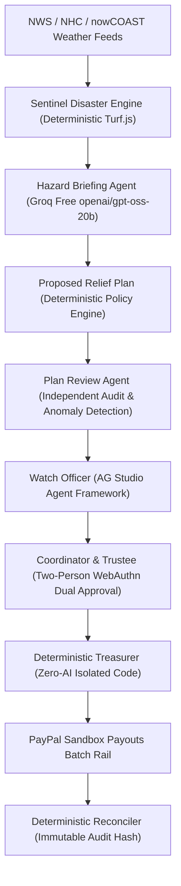

# Landfall — Multi-Agent AI & Financial Integrity Architecture

## 1. Architectural Philosophy: The Golden Rule

> **AI proposes. Rules check. Two humans approve with passkeys. Only then does PayPal move money.**

In Landfall, artificial intelligence provides operational reasoning, situation awareness, and auditing. It is architecturally barred from controlling money, approving eligibility, or setting payout amounts.

---

## 2. Agent Inventory & Responsibility Matrix

| Agent / Service | Technology | Role | Permissions | Financial Access |
|---|---|---|---|---|
| **Hazard Briefing Agent** | Groq Free `openai/gpt-oss-20b` | Reads validated NWS/NHC feeds; synthesizes meteorological threat briefings with citations. | Read-Only | **STRICTLY NONE** |
| **Watch Officer** | Groq Free `openai/gpt-oss-20b` + AG Studio Adapter | Answers operational inquiries, drives AG Grid view filtering, explains liquidity scenarios. | Read-Only UI Controls | **STRICTLY NONE** |
| **Plan Review Agent** | Groq Free `openai/gpt-oss-20b` + Deterministic Rules | Audits immutable plans for solvency margins, missing documents, duplicate addresses, prompt injection. | Audit Verdicts (Advisory) | **STRICTLY NONE** |
| **Relief Communication Assistant** | Groq Free `openai/gpt-oss-20b` + Multilingual Templates | Drafts recipient notices (EN, ES, HT, VI), unclaimed assistance instructions, and donor updates. | Draft Generation Only (No Send) | **STRICTLY NONE** |
| **Policy Engine** | Pure TypeScript (Zero AI SDKs) | Evaluates Tranche 1 eligibility, vulnerability tiers, and grant amounts. | Deterministic Calculation | Code Only |
| **Treasurer Service** | Pure TypeScript (Zero AI SDKs) | Constructs PayPal Payouts batch payloads following valid dual passkey signatures. | PayPal Sandbox Payouts Client | **Code Execution Only** |
| **Reconciler Service** | Pure TypeScript (Zero AI SDKs) | Pulls PayPal reporting balances, verifies settlement items, flags discrepancies. | Ledger Reconciliation | Code Only |

---

## 3. Zero-Cost Remote AI + Deterministic Offline Fallback

1. **Zero-Cost Mandate:** Remote inference utilizes Groq Cloud's Free Plan exclusively, leveraging `openai/gpt-oss-20b`.
2. **No Paid Fallbacks:** All calls to paid models (OpenAI, Anthropic, Gemini, OpenRouter) are prohibited.
3. **Deterministic Offline Fallbacks:** Every AI capability (Hazard Briefing, Watch Officer, Plan Review, Communication Assistant) includes a full deterministic TypeScript fallback that activates instantly if Groq experiences rate limiting (`HTTP 429`), network timeouts, or service unavailability.

---

## 4. Security & Safety Invariants

### Architectural Boundary Invariant
Automated architectural boundary tests (`tests/arch/boundary.test.ts`) inspect the codebase on every commit to enforce:
1. `lib/rules`, `lib/ledger`, `lib/treasurer`, `lib/pledges`, and `lib/treasury` must never import `ai`, `@ai-sdk/*`, `groq-sdk`, or any LLM package.
2. Webhook endpoints must never invoke AI to alter account balances.
3. Sentinel must never import payment-moving functions.

### Prompt Injection Defense
The Plan Review Agent tests all incoming strings against hostile injection patterns (`ignore previous instructions`, `bypass approval`, `admin override`). Any detected attempt is flagged as `PROMPT_INJECTION_FLAGGED` and immediately escalates the entire plan to human security review.

