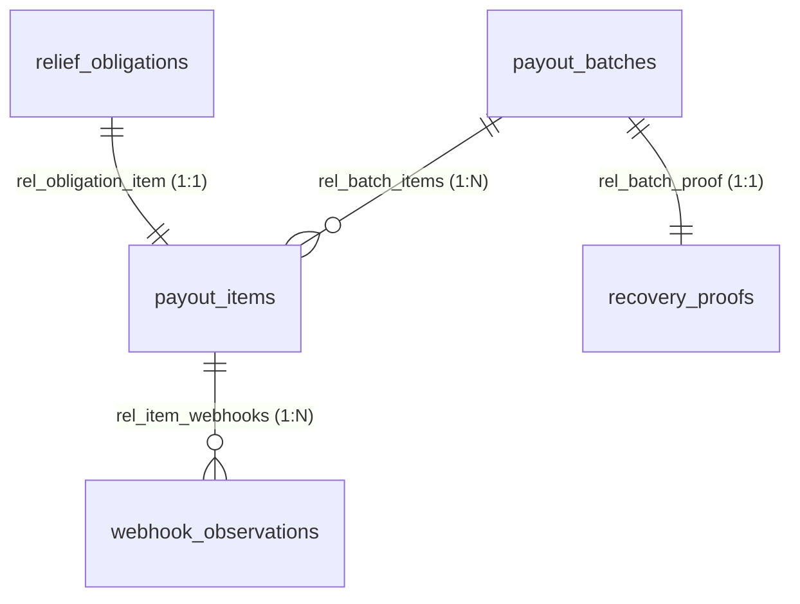

# Landfall AG Studio Analytical Data Model & Semantic Architecture

**Version:** 3.1.0  
**Target:** AG Studio (`ag-studio@3.1.0`), AG Grid (`ag-grid-community@36.3.0`, `ag-grid-enterprise@36.3.0`), AG Charts (`ag-charts-community@14.3.0`)  
**Design Reference:** `LANDFALL_AG_GRID_STUDIO_PRIZE_MASTER_SPEC.md` (§5.2, §9)

---

## 1. Architectural Principles & Modeling Invariants

1. **Explicit Granularity:** Every source has a documented primary key and immutable grain. Measures are never joined raw across one-to-many boundaries to prevent fan-out multiplication.
2. **Deterministic Financial Semantics:**
   - Exact PayPal Payouts v1 transaction statuses: `SUCCESS`, `FAILED`, `PENDING`, `UNCLAIMED`, `RETURNED`, `ONHOLD`, `BLOCKED`, `REFUNDED`, `REVERSED`.
   - Provider `SUCCESS` confirms wallet crediting only; beneficiary receipt confirmation is an explicit, distinct indicator.
   - All monetary figures are integer cents internally, mapped to formatted USD.
   - Mixed currencies are never summed without explicit exchange rate models.
3. **Double-Entry Ledger Grounding:** Every disbursement is verified against internal double-entry ledger postings with zero minor-unit discrepancy.
4. **Reserve Policy Enforcement:** The 30% reserve floor invariant ($5,000.00 protected against $14,250.00 total sandbox liquid assets) is sourced deterministically from the financial policy engine.
5. **Privacy by Design:** Resident references are pseudonymous in analytical reporting (`hh_tbw_001`, `hh_tbw_002`, etc.); full names and coordinates are excluded from browser analytics.

---

## 2. Semantic Data Sources Catalogue

### 2.1 `payout_items`
- **Grain:** 1 row per individual PayPal payout item.
- **Primary Key:** `item_id`
- **Fields:**
  - `item_id` (text, PK)
  - `batch_id` (text, FK -> `payout_batches.batch_id`)
  - `obligation_id` (text, FK -> `relief_obligations.obligation_id`)
  - `household_ref` (text, pseudonymous resident reference)
  - `resident_name` (text, sanitized audit label)
  - `zone` (text, evacuation zone)
  - `priority_tier` (text, e.g. "Tier 1 · Medical device")
  - `tier_number` (integer, 1 to 5)
  - `recipient_wallet` (text, `PAYPAL` | `VENMO`)
  - `amount_usd` (currency, e.g. $500.00)
  - `currency` (text, `USD`)
  - `transaction_status` (text, exact PayPal v1 status)
  - `status_label` (text, user-facing label)
  - `status_meaning` (text, operational explanation)
  - `is_unresolved` (integer flag, 1 = exception needing attention, 0 = resolved/credited)
  - `unresolved_usd` (currency, amount if unresolved, else 0)
  - `submitted_date` (date, YYYY-MM-DD)
  - `last_event_time` (text, ISO UTC)
  - `age_hours` (integer, hours since submission)
  - `age_band` (text, `< 6 hrs`, `6 - 24 hrs`, `24 - 48 hrs`, `> 48 hrs`)
  - `reconciliation_status` (text, `MATCHED` | `MISMATCH`)
  - `beneficiary_confirmed` (text, `CONFIRMED` | `UNCONFIRMED`)
  - `environment` (text, `SANDBOX` | `REPLAY`)
  - `safe_action` (text, recommended operator action)
  - `items_count` (integer, 1)

### 2.2 `payout_batches`
- **Grain:** 1 row per submitted PayPal Payouts v1 batch.
- **Primary Key:** `batch_id`
- **Fields:**
  - `batch_id` (text, PK)
  - `paypal_batch_id` (text, provider batch ID e.g. `7Y5GP4ETNLCUQ`)
  - `submitted_date` (date)
  - `batch_status` (text, `SUCCESS` | `SETTLED_PARTIAL` | `PROCESSING`)
  - `items_total` (integer)
  - `total_amount_usd` (currency)
  - `currency` (text, `USD`)
  - `reconciliation_gap_usd` (currency, 0 for balanced batches)
  - `environment` (text)

### 2.3 `relief_obligations`
- **Grain:** 1 row per approved household assistance obligation.
- **Primary Key:** `obligation_id`
- **Fields:**
  - `obligation_id` (text, PK)
  - `household_ref` (text)
  - `zone` (text)
  - `priority_tier` (text)
  - `tier_number` (integer)
  - `exposure_status` (text, `In warning area` | `Outside warning`)
  - `grant_usd` (currency)
  - `approval_status` (text, `DUAL_APPROVED` | `NOT_APPLICABLE`)
  - `policy_version` (text)
  - `households` (integer, 1)

### 2.4 `funding_events`
- **Grain:** 1 row per recognized contribution.
- **Primary Key:** `event_id`
- **Fields:** `event_id`, `source_type`, `amount_usd`, `currency`, `status`, `received_date`, `environment`, `donor_ref`.

### 2.5 `treasury`
- **Grain:** 1 row per treasury tranche.
- **Primary Key:** `bucket`
- **Fields:** `bucket`, `amount_usd`, `meaning`, `currency`.

### 2.6 `solvency`
- **Grain:** 1 row per reserve & solvency policy snapshot.
- **Fields:** `total_balance_usd`, `allocatable_usd`, `required_usd`, `reserve_usd`, `policy_floor_pct`, `required_reserve_usd`, `headroom_usd`, `reserve_ratio_pct`, `coverage_ratio`, `status`, `as_of`.

### 2.7 `ledger_reconciliation`
- **Grain:** 1 row per ledger account.
- **Primary Key:** `ledger_id`
- **Fields:** `ledger_id`, `account_id`, `account_name`, `debit_usd`, `credit_usd`, `balance_usd`, `variance_cents`, `match_status`, `last_verified`.

### 2.8 `approval_events`
- **Grain:** 1 row per passkey dual-custody signature.
- **Primary Key:** `approval_id`
- **Fields:** `approval_id`, `plan_hash`, `approver_role`, `approver_name`, `algorithm`, `signature_state`, `approved_at`.

### 2.9 `webhook_observations`
- **Grain:** 1 row per verified PayPal webhook observation.
- **Primary Key:** `webhook_id`
- **Fields:** `webhook_id`, `event_type`, `paypal_event_id`, `item_id`, `batch_id`, `verified`, `deduplicated`, `received_time`.

### 2.10 `grievance_summary`
- **Grain:** 1 row per grievance category.
- **Primary Key:** `category_id`
- **Fields:** `category_id`, `category`, `case_count`, `resolved_count`, `pending_count`, `avg_resolution_hours`, `status`.

### 2.11 `recovery_proofs`
- **Grain:** 1 row per settlement integrity proof.
- **Primary Key:** `proof_id`
- **Fields:** `proof_id`, `batch_id`, `merkle_root`, `ledger_balanced`, `reserve_preserved`, `signers`, `generated_at`.

---

## 3. Join Relationships Graph

- **`rel_batch_items`**: `payout_batches.batch_id` = `payout_items.batch_id` (`one-to-many`)
- **`rel_obligation_item`**: `relief_obligations.obligation_id` = `payout_items.obligation_id` (`one-to-one`)
- **`rel_item_webhooks`**: `payout_items.item_id` = `webhook_observations.item_id` (`one-to-many`)
- **`rel_batch_proof`**: `payout_batches.batch_id` = `recovery_proofs.batch_id` (`one-to-one`)

---

## 4. Date Calendars Spine

- **Identifier:** `payout_calendar`
- **Label:** `Milton Payout Timeline`
- **Range:** `2024-10-01` to `2024-10-31`
- **Fragments:** `day`, `week`, `month`
- **Bound Fact Column:** `payout_items.submitted_date`

