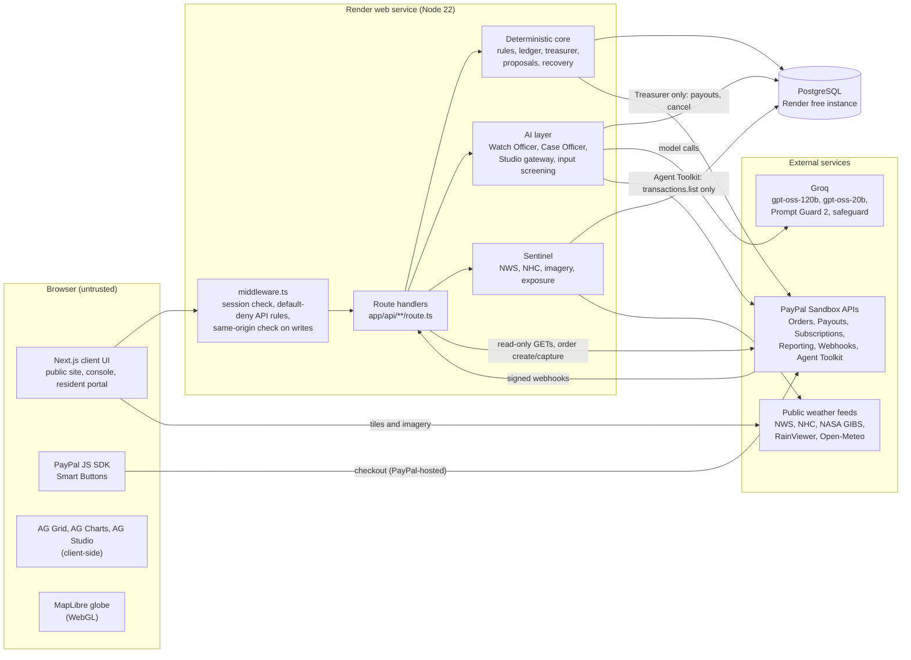
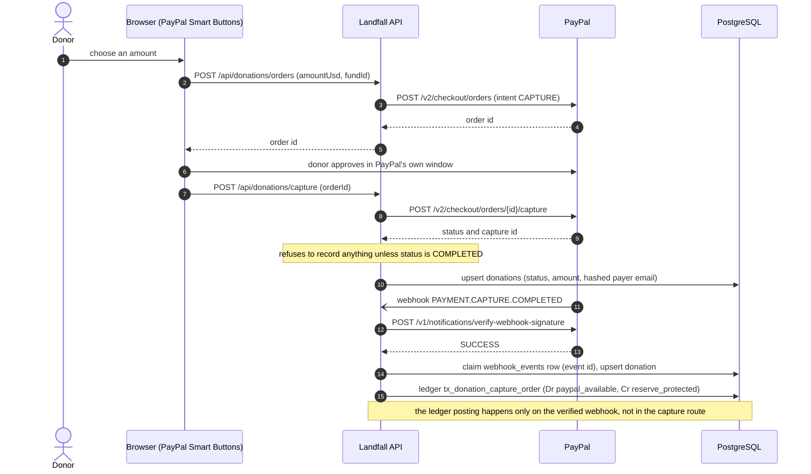
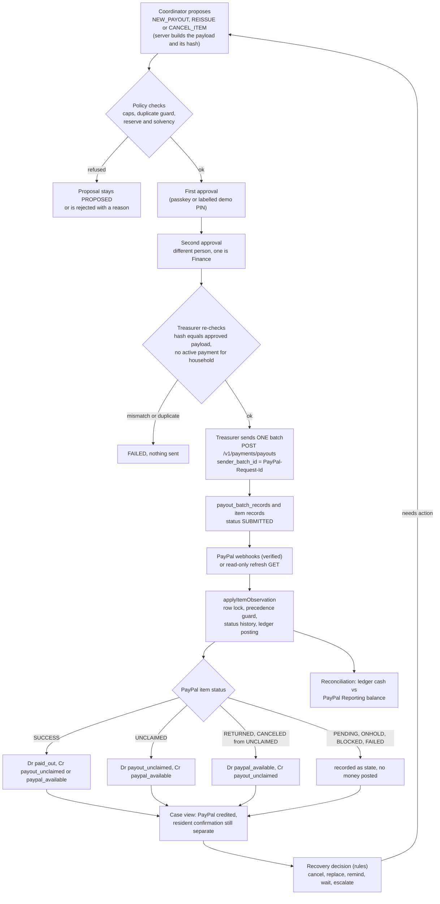
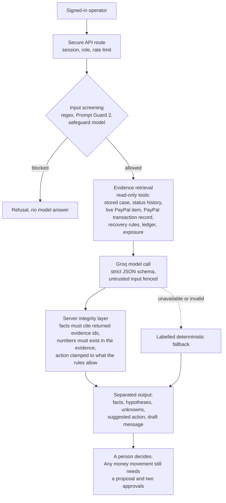
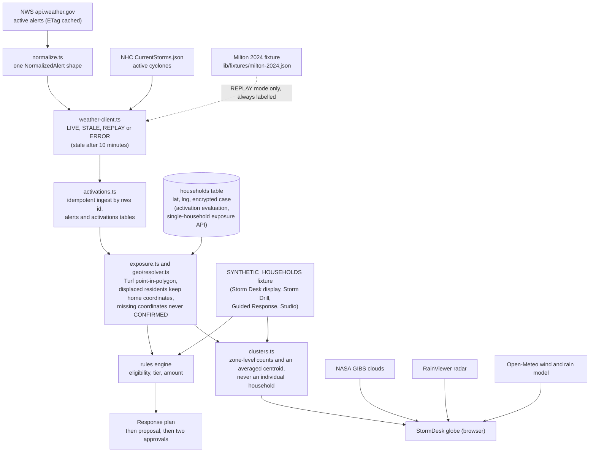
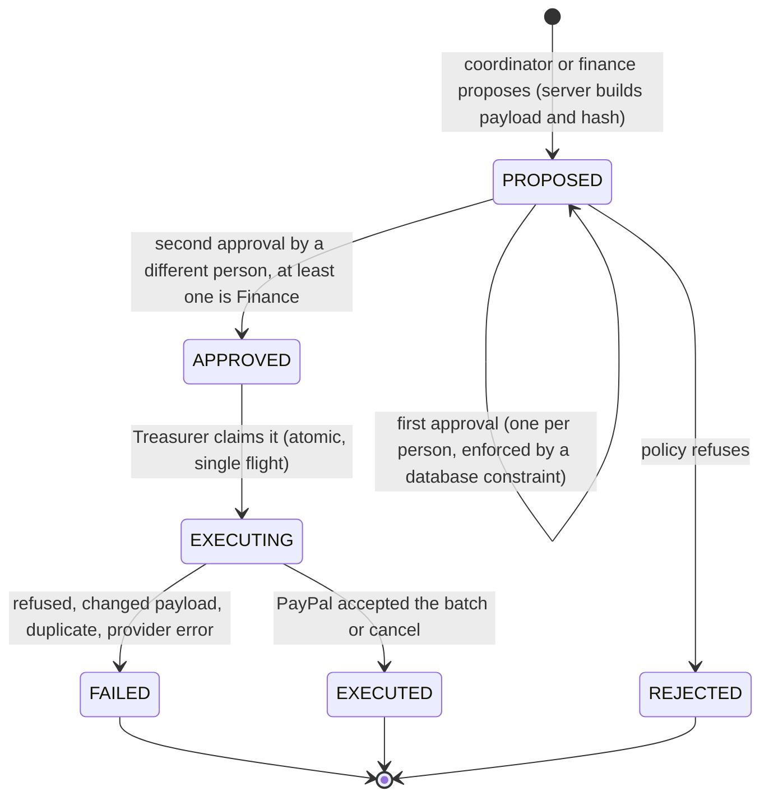
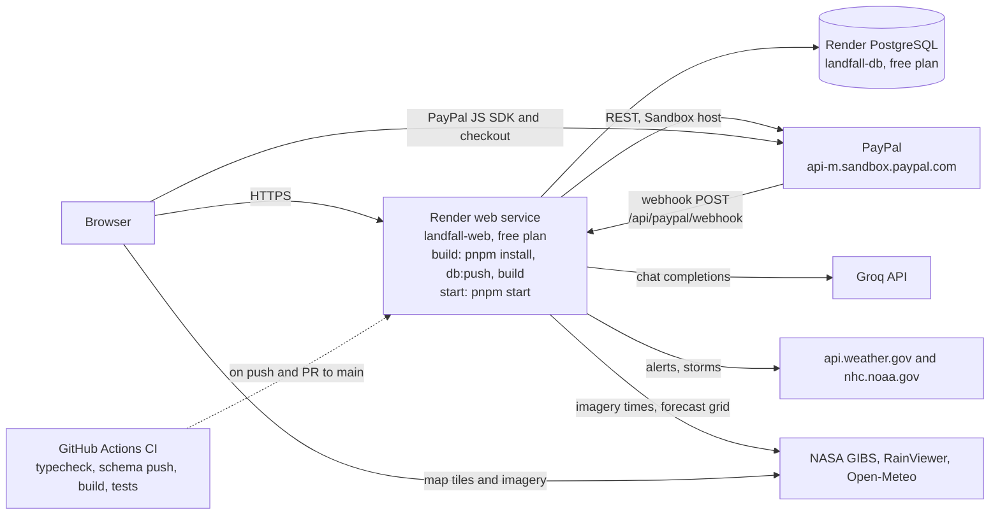

# Landfall architecture

> Status: describes the code at commit `f8f21a7` (branch `main`). Every statement is traceable to a file path, a test, or is labelled as owner-provided evidence. Where a capability is a simulation, a replay or Sandbox-only, it is said so. See [LIMITATIONS.md](LIMITATIONS.md) for what is not built and [DATA_PROVENANCE.md](DATA_PROVENANCE.md) for where every piece of data comes from.

## 1. Overview

Landfall is a single Next.js application (App Router, React 19, TypeScript) backed by one PostgreSQL database. It connects five things that humanitarian cash programmes usually keep in separate tools:

| Concern | What Landfall does | Where |
|---|---|---|
| Disaster intelligence | Reads official US warnings and tropical-cyclone data, plus satellite, radar and model layers, and tests enrolled households against warning polygons in code. | `lib/sentinel/`, `lib/geo/`, `components/sentinel/desk/` |
| Assistance rules | A pure, deterministic policy engine decides who is eligible, in what priority order, and for how much. | `lib/rules/` |
| Money | A double-entry ledger, a Treasurer that is the only code allowed to create or cancel PayPal payouts, and a reconciler. | `lib/ledger/`, `lib/treasurer/`, `lib/treasury/`, `lib/paypal/` |
| Governance | Every payout or recovery action is a *proposal* that needs two different people (one from Finance) to approve the exact payload hash. | `lib/proposals/`, `lib/security/webauthn.ts` |
| Accountability | One *case* per payment joins PayPal's status, the ledger, webhooks, the resident's own report and the recovery rules, and an AI officer investigates read-only. | `lib/relief/`, `lib/recovery/`, `lib/ai/` |

The operating rule, enforced by structure and by tests rather than by convention:

> **Official data informs. Deterministic rules decide. AI explains and challenges. People authorise. PayPal moves money. Reconciliation verifies.**

### Architectural invariants (and how each is enforced)

| Invariant | Enforcement |
|---|---|
| Only the Treasurer may create or cancel PayPal payouts. | `tests/arch/boundary.test.ts` (Invariant 1) scans `lib/` and fails if anything outside `lib/treasurer/` and `lib/paypal/payouts.ts` references the Payouts module. It is a textual scan of `lib/`, not an AST analysis, and it does not scan `app/`. |
| The deterministic money core never imports an AI SDK. | Same file (Invariant 2) for `lib/rules`, `lib/ledger`, `lib/treasurer`, `lib/pledges`, `lib/treasury`. |
| The AI has no tool that can write. | Tool sets are fixed in code ([AI_ARCHITECTURE.md](AI_ARCHITECTURE.md)); the Watch Officer and Case Officer tools only read; the Studio agent's tools can only edit a dashboard. |
| Two different people approve the *exact* payload. | `lib/proposals/approvals.ts` (pure rule), a database unique constraint `action_approvals_one_per_person`, and a hash of the payload that is re-checked at execution (`lib/treasurer/recovery.ts`). |
| Every API route has an explicit access rule; the default is deny. | `lib/auth/policy.ts` + `middleware.ts`; `tests/security/access-matrix.test.ts` walks every `route.ts` and fails if one has no rule. |
| Ledger transactions balance. | `validateBalancedTransaction` in `lib/ledger/index.ts` rejects unbalanced or negative entries before any write. |

## 2. System architecture

**Trust boundaries.** (1) The browser is untrusted: roles and identities come from the signed session cookie, never from a request body. (2) The `app/api` layer is the only door to the database and to PayPal. (3) Inside the server, the *deterministic core* is separated from the *AI layer*: the core imports no AI SDK, and the AI layer calls the core only through read-only functions. (4) PayPal and Groq are external; their responses are schema-validated with Zod before use and never trusted for authorisation.

## 3. Frontend architecture

| Aspect | Implementation |
|---|---|
| Framework | Next.js 15.1 App Router, React 19, TypeScript strict, Tailwind CSS 3. Console pages are client components; the root layout is `app/layout.tsx`. |
| Three shells | `components/layout/UnifiedAppShell.tsx` renders a **public** shell (marketing site, sign-in), a **console** shell (sidebar, data-source switch, session chip, "next step" footer) and a **resident** shell (plain language; the enrolment form offers en, es, ht, vi and zh). |
| One ordered flow | `components/layout/flow.ts` is the single list that drives the sidebar, the "Next" footer on every console page and the guided tour: *Command Center → Before landfall (Storm Desk, Storm Drill) → Decide and pay (Guided Response, Approvals, Households) → Did it land? (Payments, AI Watch Officer, Analytics Studio)*. |
| Live vs replay | `components/data/DataSourceProvider.tsx` loads cases from `/api/cases`. With real PayPal Sandbox records in the database the console shows them ("Live Sandbox"); otherwise, or when switched, it shows a synthetic Hurricane Milton replay. The header always says which. |
| AG Grid | `components/grid/CaseGrid.tsx` (payments) and `components/recipients/HouseholdGrid.tsx` (households), both AG Grid Enterprise with one theme from `styles/ag-studio-theme.ts`. |
| AG Studio | `components/studio/StudioCanvas.tsx`: a themed AG Studio workspace with three custom widgets and a Studio Agent. Its data is the synthetic replay dataset (`lib/studio/landfall-studio-data.ts`). |
| Globe | `components/sentinel/desk/StormDesk.tsx` (MapLibre + custom WebGL layers for cloud decks, rain and wind). The landing page reuses it as the hero. |
| Motion | GSAP (`gsap`, `@gsap/react`): page entrances, the sliding nav marker, scroll story on the landing page, the tour spotlight. All respect `prefers-reduced-motion`. |
| Design system | `styles/design-tokens.css`, `styles/typography.css`, `styles/components.css`; rationale in [DESIGN_SYSTEM.md](DESIGN_SYSTEM.md). |

## 4. Backend and API layer

* **Route handlers** live in `app/api/**/route.ts` (49 route files exposing 63 route–method pairs; the full inventory is in [API.md](API.md)). Inputs are validated with Zod; errors go through `lib/http/safe-error.ts`, which logs the real error with a short reference and returns only a fixed message plus that reference.
* **Edge middleware** (`middleware.ts`): (a) `/console/*` requires a session whose role is an operator role, else redirects to `/signin?next=…`; (b) every `/api/*` path must match a rule in `lib/auth/policy.ts` or it is answered `403`; (c) state-changing API calls that carry a session cookie must be same-origin (`Origin` host equals `Host`, or `Sec-Fetch-Site` is `same-origin`/`none`).
* **Route-level guards** (`lib/auth/guard.ts`) add finer checks (for example, only `coordinator`/`finance` may approve; a resident may only read their own household).
* **Rate limiting** (`lib/security/rate-limit.ts`): in-memory sliding window per session id or trusted client IP. It lives in one process, so limits are per instance and reset on restart.
* **Public pages** (`/`, `/signin`, `/judges`, `/r/*`, `/validate`) need no session.

## 5. Database architecture

PostgreSQL through Drizzle ORM (`drizzle-orm`, `drizzle-kit`). The schema is a single file, `lib/db/schema.ts` (44 tables). There is **no versioned migration folder**: the schema is applied with `drizzle-kit push` (`pnpm db:push`), which Render runs at build time (`render.yaml`). Entities, keys and constraints are described in [DATA_MODEL.md](DATA_MODEL.md).

Two generations of payout tables exist. `payout_batches` / `payout_items` predate the Treasurer and have **no writers**; the live path writes `payout_batch_records`, `payout_item_records` and the append-only `payout_status_history`. Several other tables are declared but have no writers in the current code (for example `ai_runs`, `reconciliation_runs`, `audit_verdicts`); [DATA_MODEL.md](DATA_MODEL.md) lists them.

## 6. Financial ledger architecture

A double-entry ledger in `ledger_accounts` / `ledger_entries`, written only through `recordLedgerTransaction`, which validates that debits equal credits and runs inside a database transaction. Transaction ids are deterministic (for example `payout_<item>_success`, `tx_donation_capture_<order>`), which makes posting idempotent. Full account list, posting rules per PayPal status, and the treasury formulas are in [FINANCIAL_LEDGER.md](FINANCIAL_LEDGER.md).

## 7. PayPal integration

PayPal Sandbox only (`PAYPAL_ENV` selects the host; there is a single credential pair). Orders v2 (donations), Payouts v1 (relief and cancel), Webhooks with server-side signature verification, Reporting (balances, transactions), Subscriptions (monthly sustainers), Vault v3 (code complete, blocked by Sandbox permissions) and the official Agent Toolkit (read-only). Details and the exact flows are in [PAYPAL_INTEGRATION.md](PAYPAL_INTEGRATION.md).

### 7.1 Donation flow

### 7.2 Payout lifecycle

## 8. AI architecture

Four AI surfaces, all server-side Groq calls except the Studio agent loop which runs its tools in the browser. Full detail, limits and tests are in [AI_ARCHITECTURE.md](AI_ARCHITECTURE.md).

## 9. Weather and geospatial architecture

The satellite, radar and model layers are **display** layers. Only NWS warning polygons feed the exposure calculation. Detail on which feed is live, stale, replayed or unavailable is in [DATA_PROVENANCE.md](DATA_PROVENANCE.md).

## 10. AG Grid, AG Charts and AG Studio

* **AG Grid Enterprise** (`ag-grid-enterprise` 36.3): row grouping, master/detail evidence rows, set filters, a custom status-bar panel, sparkline column, integrated charts (range to chart), custom context menu and tooltip, CSV/Excel export, persisted grid state, a custom "no rows" overlay. Registered once in `lib/ag/register.ts`.
* **AG Charts** (`ag-charts-community`/`ag-charts-react` 14): the money donut on the Command Center and integrated charts inside the grid.
* **AG Studio** (`ag-studio`, `ag-studio-react` 3.1): a themed workspace, three custom widgets under a "Landfall Relief Intelligence" group (`ReserveGuardrailWidget`, `PayoutLifecycleWidget`, `RecoveryEvidenceChainWidget`) plus `SolvencyWidget`, and a **Studio Agent** built with `createAiHarness`, `directLlmRunner` and a custom `GroqStudioLlmAdapter` that calls `/api/studio-llm`. One custom tool (`create_recovery_page`) is defined with `api.defineAiTool`. The agent can read the Studio data and edit the dashboard; no tool can touch money.
* **Licences** are read from `NEXT_PUBLIC_AG_GRID_LICENSE` and `NEXT_PUBLIC_AG_STUDIO_LICENSE`; if absent AG's own notice and watermark stay visible by design (`lib/ag/register.ts`).

## 11. Authentication and authorisation

| Mechanism | Detail | Where |
|---|---|---|
| Session | A signed cookie `lf_session`: `base64url(payload).base64url(HMAC-SHA256(secret, payload))`, 8-hour TTL, Web Crypto only so it runs in edge middleware and route handlers. The payload is signed, not encrypted, and holds a display name, a role and (for residents) a household id. | `lib/auth/session.ts` |
| Operator sign-in | **Demo personas only** (Dana Ortiz coordinator, Sam Patel finance, Judge read-only), one click, enabled by `JUDGE_MODE_ENABLED`. There is no username/password or SSO. | `lib/auth/personas.ts`, `app/api/auth/session` |
| Roles | `coordinator`, `finance`, `viewer`, `resident`. Access classes: `public`, `webhook`, `cron`, `operator`, `staff`, `finance`, `resident`, `resident-operator`. | `lib/auth/policy.ts` |
| Resident access | A 6-digit code = HMAC-SHA256(server secret, epoch and household id); six wrong codes lock a household for 15 minutes (in-memory counter). | `lib/auth/resident-code.ts` |
| Passkeys | WebAuthn registration and approval via `@simplewebauthn/server`; the approval challenge is single-use and bound to the payload hash; signature counter is updated. | `lib/security/webauthn.ts` |
| Demo approval PIN | A labelled fallback for devices without a passkey authenticator, shown on the judge card; refused whenever `PAYPAL_ENV=live`. | `lib/security/demo-key.ts` |
| Cron | `CRON_SECRET` bearer, constant-time compare, fails closed when unset. | `lib/auth/cron.ts` |

## 12. Human approval workflow

Policy validation before the first approval and again at execution: payout caps (`LIVE_PAYOUT_MAX_ITEM_CENTS`, `LIVE_PAYOUT_MAX_TOTAL_CENTS`; defaults $100 per item and $50 per proposal in this Sandbox build), at most 20 households per proposal, a duplicate guard (a household with an active payment cannot be paid again), the reserve and solvency rule, an emergency-stop flag (`EMERGENCY_STOP`), and equality between the approved hash and the plan about to be sent. Every approval and execution writes an `audit_events` row. Approvers' roles come from the signed session at approval time.

## 13. Webhook processing

`app/api/paypal/webhook/route.ts`, in order: parse JSON; require `PAYPAL_WEBHOOK_ID` (else `503`); require all five PayPal signature headers (else `401`); verify through PayPal's `verify-webhook-signature` API (else `401`); **only then** insert a `webhook_events` row keyed by the PayPal event id (`ON CONFLICT DO NOTHING`); a row whose `processed_at` is set is acknowledged as a duplicate, while a row that was claimed but never finished is processed again; dispatch by event type; set `processed_at` last. Handlers are idempotent. Out-of-order protection: payout items use a per-row lock, a status-precedence guard (`shouldUpdatePayoutStatus`) and the webhook's own `create_time` (`STALE_EVENT`); subscriptions use `shouldUpdateSubscriptionStatus`.

## 14. Background jobs and scheduled workers

There is **no scheduler in the deployment**. `render.yaml` defines no cron service (Render cron jobs have no free tier). Two endpoints exist for an external scheduler and fail closed without `CRON_SECRET`: `POST /api/alerts/poll` (NWS ingest) and `POST /api/payouts/refresh-due` (read-only refresh of batches not synced in the last 10 minutes). `pnpm cron:poll` calls both. In practice status arrives by verified webhook, or an operator presses **Refresh from PayPal** (`POST /api/payouts/refresh`, 15-second per-batch cool-down).

## 15. Deployment architecture

Render auto-deploys from `main`. CI (`.github/workflows/ci.yml`) does **not** deploy; it runs on a disposable PostgreSQL service container. Configuration and environment are in [DEPLOYMENT.md](DEPLOYMENT.md).

## 16. Logging and observability

* **`audit_events`**: every PayPal HTTP call (method, URL, body, response, `PayPal-Debug-Id`, actor), proposal approvals and executions, and Case Officer investigations. Payloads are redacted before writing (`lib/db/audit-redact.ts`: recipient emails, phones, PayPal ids).
* **`webhook_events`** keeps the verified payload of every webhook; **`payout_status_history`** keeps every status change and its source; **`watch_officer_runs`** and **`agent_events`** keep every Watch Officer run (query, evidence, response, model, latency); **`pii_access_log`** records decrypted-PII access.
* Server `console` logs carry an error reference (`[api-error ab12cd34]`) that matches the reference shown to the user.
* There is no metrics, tracing or alerting stack, and no log shipping, in this repository.

## 17. Failure handling

| Failure | Behaviour | Evidence |
|---|---|---|
| PayPal unreachable or slow | 15 s timeout per call; retries (max 2) only for GETs and POSTs carrying an idempotency key; a payment-creating POST without a key is never retried. Unknown outcome on send: never auto-resend; the proposal is marked `FAILED` with "check PayPal's status before trying again". | `lib/paypal/client.ts`, `lib/proposals/execute.ts`, `tests/paypal/client-resilience.test.ts` |
| Duplicate webhook | Acknowledged, not re-applied. Crash mid-processing: PayPal's retry processes it again. | `app/api/paypal/webhook/route.ts`, `tests/paypal/webhook-gate.test.ts` |
| Out-of-order status | Blocked by the precedence guard, `STALE_EVENT` flag, row lock. | `lib/payouts/store.ts`, `tests/payouts/` |
| Unknown PayPal status | Recorded with an `UNKNOWN_STATUS` flag; never overwrites a recognised status. | `lib/payouts/store.ts` |
| Amount or currency mismatch | Flagged (`AMOUNT_MISMATCH`, `CURRENCY_NOT_USD`) and audited. | `lib/payouts/store.ts` |
| Groq unavailable, rate-limited or invalid | Retry on the sibling model (separate rate-limit bucket), then a **labelled** deterministic fallback; the UI says which answered. | `lib/ai/groq.ts`, `lib/ai/watch-officer/orchestrator.ts`, `lib/ai/case-officer/index.ts` |
| Weather feed outage | State becomes `STALE` after 10 minutes and `ERROR` with no cached alerts; "zero fabricated hazard data". Individual layers show "unavailable". | `lib/sentinel/weather-client.ts` |
| Reconciliation cannot reach PayPal | Status `UNVERIFIED`, never "matched". A ledger-only view is `FALLBACK_LEDGER_ONLY`, never "matched". | `lib/treasury/reconciler.ts` |
| Database failure | Routes return a safe `503`/`500` with a reference; nothing is retried automatically. | `lib/http/safe-error.ts` |

## 18. Data privacy and security boundaries

* **PII at rest**: names and addresses are encrypted with AES-256-GCM (`lib/security/encryption.ts`, format `v1:iv:tag:ciphertext`) before they enter `households.case_json`. If `PII_ENCRYPTION_KEY` is unset the code falls back to a deterministic **development** key; `render.yaml` does not declare that variable ([LIMITATIONS.md](LIMITATIONS.md)).
* **PII in views**: the household directory masks receivers and shows `[ENCRYPTED]` unless the *server* sets `PII_DECRYPT_ENABLED=true`; a caller cannot request decryption, and every decryption writes `pii_access_log`.
* **Map privacy**: the Storm Desk shows zone-level clusters (counts and an averaged centroid to four decimals, `lib/sentinel/clusters.ts`), never an individual household; the household directory API rounds coordinates to two decimals unless the server enables reveal (`lib/security/mask.ts`, `app/api/recipients/route.ts`). **Note:** the clusters shown on the Storm Desk are computed from `SYNTHETIC_HOUSEHOLDS` (`lib/fixtures/households.ts`), not from the enrolled-household table.
* **No government ID, SSN or immigration status** is ever requested (`lib/recipients/index.ts`).
* **Secrets** are read from environment variables only; the only `NEXT_PUBLIC_*` variables allowed in `lib/env.ts` are the PayPal client id and the two AG licence keys (`tests/arch/boundary.test.ts`, Invariant 4).
* **Browser hardening** (`next.config.mjs`): `X-Content-Type-Options`, `X-Frame-Options: DENY`, `Referrer-Policy`, HSTS and a Content-Security-Policy that allowlists PayPal, NASA, NOAA, RainViewer and Open-Meteo origins. The CSP allows `'unsafe-inline'` and `'unsafe-eval'` for scripts, which weakens it as an XSS defence.

For threats and residual risks see [THREAT_MODEL.md](THREAT_MODEL.md) and [../SECURITY.md](../SECURITY.md).
