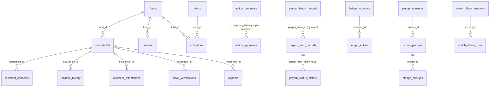

# Data model

> Source of truth: [`lib/db/schema.ts`](../lib/db/schema.ts) (Drizzle ORM, PostgreSQL 16, **44 tables**). The schema is applied with `drizzle-kit push` (`pnpm db:push`); the repository has **no migration history**. Facts below were read from the schema and from the code that uses each table; "used" means application code under `app/` or `lib/` reads or writes it, determined by searching the source (tests and scripts excluded). Related: [ARCHITECTURE.md](ARCHITECTURE.md), [FINANCIAL_LEDGER.md](FINANCIAL_LEDGER.md), [API.md](API.md).

## 1. Shape of the data

Landfall keeps two kinds of records:

1. **Records it creates and controls**: households, consents, proposals, approvals, ledger entries, AI runs, audit events.
2. **Records that mirror what PayPal said**: donations, subscriptions, payout batch/item records and their status history, webhook events. For these, PayPal is the source of truth and Landfall stores *the last thing PayPal told it*, plus where and when it learned it.

The payout-record tables are joined **by value** (`sender_item_id`, `paypal_batch_id`), not by foreign key, on purpose: the guided flow that produces payouts does not create the uuid plan/household rows the older payout tables point to (see §4).

## 2. Table inventory

"Used" = referenced by application code. "Unused" = defined in the schema but no application code reads or writes it today (they are candidates for removal or for the roadmap, [ROADMAP.md](ROADMAP.md)).

### Money and PayPal mirror

| Table | Purpose | Key constraints | Used |
|---|---|---|---|
| `ledger_accounts` | Chart of accounts (`paypal_available`, `reserve_protected`, `payout_unclaimed`, …) with a cached `balance numeric(14,2)` | PK `id` (text) | yes |
| `ledger_entries` | One row per leg of a double-entry transaction (`DEBIT`/`CREDIT`, `numeric(14,2)`) | FK `account_id`; the application writes legs with deterministic transaction ids so a replay is a no-op ([FINANCIAL_LEDGER.md](FINANCIAL_LEDGER.md)) | yes |
| `hosts` | Legal entity that holds the PayPal account | PK uuid | yes (ledger bootstrap) |
| `donations` | One row per captured Orders v2 order | unique `paypal_order_id`; `amount` is **text**; payer email stored as SHA-256 `donor_email_hash` | yes |
| `subscriptions` | Monthly sustainers | unique `paypal_subscription_id`; `donor_email` may be clear text or `sha256:<hash>` (see [PAYPAL_INTEGRATION.md](PAYPAL_INTEGRATION.md#3-monthly-sustainers-subscriptions)) | yes |
| `webhook_events` | Every webhook received, verified or not | PK `paypal_event_id` (this is what makes re-delivery idempotent); `verified`, `processed_at` | yes |
| `payout_batch_records` | One row per PayPal payout batch Landfall recorded | unique `paypal_batch_id`, unique `sender_batch_id`; `amount_cents`, `fee_cents` integers; `last_sync_source` ∈ creation/refresh/webhook | yes |
| `payout_item_records` | One row per payment, keyed by our deterministic `sender_item_id` | unique `sender_item_id`, unique `paypal_item_id`; `status` is PayPal's vocabulary plus the internal `SUBMITTED`; `amount_cents` integer | yes |
| `payout_status_history` | Append-only log of each status change (from → to, source, webhook event id, ledger transaction ids) | none (append-only by convention) | yes |
| `storm_pledges`, `pledge_consents` | Contingent donor pledges and the consent text that authorises them | FK `consent_id` | yes (create/revoke only) |
| `pledge_charges` | Charges against a pledge (idempotency key, outbox payload) | unique `idempotency_key` | **unused**: no code ever charges a pledge ([LIMITATIONS.md](LIMITATIONS.md)) |
| `reconciliation_runs` | Intended history of ledger-vs-PayPal comparisons | none | **unused**: reconciliation results are returned to the caller and written to `audit_events`, not stored here |
| `payout_plans`, `approvals`, `audit_verdicts`, `payout_batches`, `payout_items` | The *original* plan/approval/batch model, before the Treasurer existed | FKs to plan/household uuids | `payout_plans` and `approvals` are only **read** by the Watch Officer's plan tool; `audit_verdicts`, `payout_batches`, `payout_items` are **unused** |

### Authority and approvals

| Table | Purpose | Key constraints | Used |
|---|---|---|---|
| `action_proposals` | A request to cancel, pay or re-issue; stores the exact payload and its hash | unique `idempotency_key`; `status` PROPOSED → APPROVED → EXECUTING → EXECUTED / FAILED / REJECTED | yes |
| `action_approvals` | One approval per person | `unique(proposal_id, approver_id)`; `method` WEBAUTHN or DEMO_KEY; `payload_hash` recorded | yes |
| `passkey_credentials` | WebAuthn public keys for staff personas | PK credential id; `counter` | yes |
| `webauthn_challenges` | Single-use challenges bound to a payload hash | PK `challenge`; `expires_at`, `used_at` | yes |

### Households and recipients

| Table | Purpose | Used |
|---|---|---|
| `households` | The recipient record. `case_json` holds the structured case (name and address as AES-256-GCM ciphertext); lat/lng and `receiver` are separate columns | yes |
| `recipient_consents` | Unbundled consent per purpose (terms, payment routing, location, emergency disclosure) with method (self, verbal to volunteer, paper) | yes |
| `location_history` | Address (encrypted) and coordinates over time; supports displacement | yes |
| `volunteer_attestations` | Assisted-enrolment evidence | yes |
| `email_verifications` | Hashed email-verification tokens with expiry | yes (token delivery is not implemented, [LIMITATIONS.md](LIMITATIONS.md)) |
| `appeals` | Resident appeals with a 24-hour SLA deadline | yes |
| `access_reports` | Resident-reported "received" / "can't access" evidence; never changes PayPal's status | yes |
| `identity_links`, `documents`, `risk_reports`, `messages` | Designed for PayPal identity linking, document reads, stored risk reports and outbound messages | **unused** |

### Storm intelligence

| Table | Purpose | Used |
|---|---|---|
| `alerts` | NWS alerts (live) and replay alerts, tagged `source` and `mode` (LIVE / HISTORICAL_REPLAY / SYNTHETIC) | yes |
| `activations` | Fund activation created when an eligible alert triggers | yes |
| `funds`, `policies` | The fund and its confirmed rule set | yes |

### AI, audit and feedback

| Table | Purpose | Used |
|---|---|---|
| `watch_officer_runs` | Each Watch Officer answer with its evidence and the model that produced it | yes |
| `watch_officer_sessions` | Session grouping for the above | **unused** |
| `agent_events` | Per-run tool-call events | yes (Watch Officer) |
| `ai_runs` | Intended general AI run log | **unused**: a Case Officer investigation is recorded as an `audit_events` row (`case.investigated`) instead |
| `audit_events` | Redacted request/response of significant actions (`case.investigated`, `proposal.*`, `paypal_lipp_verified`, reconciliation…) | yes |
| `pii_access_log` | Who decrypted which household fields | yes (written only when a server operator enables reveal) |
| `validation_responses` | Consented stakeholder feedback (only the count is ever shown) | yes |

Counts: 33 tables used by application code, 11 unused (`identity_links`, `documents`, `risk_reports`, `audit_verdicts`, `payout_batches`, `payout_items`, `reconciliation_runs`, `ai_runs`, `pledge_charges`, `watch_officer_sessions`, `messages`).

## 3. Where integrity is enforced

| Guarantee | Enforced by | Strength |
|---|---|---|
| One approval per person per proposal | `unique(proposal_id, approver_id)` | Database constraint |
| One proposal per idempotency key | unique `action_proposals.idempotency_key` | Database constraint |
| One payout record per sender item / PayPal item | unique `sender_item_id`, `paypal_item_id` | Database constraint |
| One webhook event processed once | PK `webhook_events.paypal_event_id` | Database constraint |
| One donation per order | unique `donations.paypal_order_id` | Database constraint |
| Ledger transactions balance | `recordLedgerTransaction` refuses unbalanced legs; deterministic ids make a replay a no-op | **Application-level** (no database trigger or check constraint) |
| Ledger account balance equals the sum of entries | Updated in the same transaction as the entries | Application-level |
| Payout status never goes backwards | `applyItemObservation` under a row lock, with a precedence guard | Application-level, tested ([TESTING.md](TESTING.md)) |
| Approver identity and the approved payload | Taken from the signed session and the stored proposal; the request body carries only proof | Application-level |

## 4. Legacy and duplicated structures

* **Two payout models.** `payout_plans` / `approvals` / `payout_batches` / `payout_items` come from the first design and require uuid plan and household rows. The Treasurer-era flow keys by `sender_item_id` and uses `payout_batch_records` / `payout_item_records` / `payout_status_history`. The schema file says so in a comment. Only the second set carries real data.
* **Money types are not uniform.** Ledger uses `numeric(14,2)`; payout records use integer cents; `donations.amount` and `payout_items.amount` are text; subscription and pledge amounts are `numeric(10,2)`. Conversions happen in code and are covered by tests; a single representation would be simpler ([ROADMAP.md](ROADMAP.md)).
* **No migrations.** `pnpm db:push` diffs the schema against the database; on Render the build runs it with `--force` against an empty database ([DEPLOYMENT.md](DEPLOYMENT.md)). Changing a column on a database with data needs a migration plan the repository does not yet contain.

## 5. Sensitive fields

| Data | Where | Protection as implemented |
|---|---|---|
| Household name and address | `households.case_json` (`encryptedName`, `encryptedAddress`), `location_history.address` | AES-256-GCM (`v1:<iv>:<tag>:<ciphertext>`) with a key from `PII_ENCRYPTION_KEY`. **If that variable is not set, a fixed fallback key written in the source code is used** (`lib/security/encryption.ts`). `render.yaml` and `.env.example` do not set it, so a deployment that follows them encrypts with a key anyone can read in this public repository. Set a real key before storing any real person's data. |
| Payment receiver (PayPal email or id) | `households.receiver`, `email_verifications.email` | **Stored in clear text** in these columns. API responses mask it (`maskReceiver`) unless a server operator enables reveal. Payout routes used for Sandbox sends come from the server-side `SANDBOX_RECEIVERS` setting and are never returned. |
| Coordinates | `households.lat/lng/current_*`, `location_history` | Clear in the database; rounded to about 1 km in API responses unless reveal is enabled. |
| Donor / payer email | `donations.donor_email_hash` (SHA-256), `subscriptions.donor_email`, `pledge_consents.donor_email`, `storm_pledges.donor_email` | Hash for one-time donations; **clear text** for pledges and for the subscription row created at checkout. |
| Complaint contact email | In-process memory only (see below) | Masked for operators; never returned to residents. |
| Audit payloads | `audit_events` | Recipient addresses and email-like values are redacted before storage (`lib/db/audit-redact.ts`). |

Not stored in the database: **resident grievances** (`POST /api/recipients/complaints`) live in a per-process in-memory array and disappear on restart ([LIMITATIONS.md](LIMITATIONS.md)). Resident-reported access evidence (`access_reports`) *is* stored.

## 6. Synthetic data and provenance

See [DATA_PROVENANCE.md](DATA_PROVENANCE.md). In short: the demonstration households, the Milton 2024 replay and the Storm Drill fixtures are synthetic or historical and are labelled as such in the interface; live NWS alerts and PayPal Sandbox records are real *inputs* but concern no real beneficiary.
