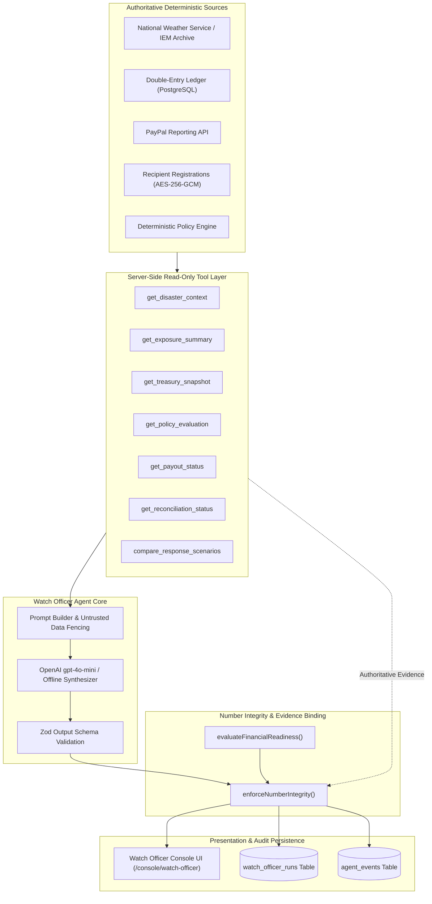

# LANDFALL M6 — AGENT ARCHITECTURE SPECIFICATION
### Watch Officer AI Operational Intelligence Subsystem
### PayPal AI Hackathon 2026 · Landfall v3

---

## 1. Architectural Overview

The **Watch Officer** is the operational intelligence core of Landfall v3. During humanitarian disasters, coordinators and finance officers face high cognitive loads: active weather warnings, varying recipient vulnerability tiers, fluctuating PayPal cash balances, contingent pledge pools, and strict multi-sig governance requirements.

The Watch Officer acts as an operational copilot that synthesizes this multifaceted state into structured, traceable intelligence.



---

## 2. Fundamental Safety Invariants

The Watch Officer architecture strictly enforces five non-negotiable safety rules:

1. **AI NEVER Controls Money:**
   The AI agent cannot initiate, authorize, approve, or execute payments. It has zero access to PayPal Payouts APIs or PayPal Vault pledge charging functions.
2. **Deterministic Rules Rule Supreme:**
   Eligibility, priority tiers, household payout amounts, and reserve waterfalls are computed exclusively by pure TypeScript deterministic code (`lib/rules/engine.ts`, `lib/treasury/readiness.ts`).
3. **Number Integrity Enforcement:**
   Financial and operational numbers (e.g. allocatable balance, required funding, eligible household count) must match authoritative server evidence. The server intercepts and overrides any hallucinated numbers prior to rendering.
4. **Untrusted Data Demarcation:**
   All external text—including NWS weather alerts, recipient appeals, donor notes, and user inquiries—is treated as untrusted and demarcated with strict prompt fences.
5. **Architectural Isolation:**
   Verified at build-time and test-time: `lib/ai/**` never imports `@/lib/paypal/payouts` or `createPayoutBatch`, and core engines never import AI libraries.

---

## 3. Server-Side Read-Only Tool Layer

All data delivered to the agent is extracted server-side through seven dedicated functions in `lib/ai/watch-officer/tools.ts`:

### 1. `get_disaster_context(context)`
- **Purpose:** Ingests live or replayed disaster telemetry from Sentinel.
- **Returns:** Active event headline, VTEC phenomena, Tranche 1 eligibility status, staleness indicator, and operational mode (`LIVE` vs `HISTORICAL_REPLAY`).
- **Evidence Format:** `ev_disaster_<timestamp>`

### 2. `get_exposure_summary(context)`
- **Purpose:** Aggregates recipient registrations and geographic exposure without leaking PII.
- **Returns:** Total registered households, confirmed exposure count, out-of-area count, needs review count, displaced count, and priority tier distribution (Tier 1 Medical to Tier 6 General).
- **Evidence Format:** `ev_exposure_<timestamp>`

### 3. `get_treasury_snapshot(context)`
- **Purpose:** Queries internal double-entry ledger accounts and active Vault pledges.
- **Returns:** Liquid PayPal available balance, reserve-protected operating balance, fees reserved, committed plan amounts, allocatable cash balance, and uncaptured contingent storm pledges.
- **Evidence Format:** `ev_treasury_<timestamp>`

### 4. `get_policy_evaluation(context)`
- **Purpose:** Evaluates deterministic policy against confirmed exposed households.
- **Returns:** Payout amount per household ($100 Tranche 1), total required funding, funded household count, waitlisted household count, funding gap, and equity summary.
- **Evidence Format:** `ev_policy_<timestamp>`

### 5. `get_payout_status(context)`
- **Purpose:** Inspects active payout plan and multi-sig WebAuthn approval state.
- **Returns:** Plan ID, plan hash, Coordinator passkey approval status, Finance passkey approval status, remaining required signatures, and item dispatch status.
- **Evidence Format:** `ev_payouts_<timestamp>`

### 6. `get_reconciliation_status(context)`
- **Purpose:** Validates internal ledger consistency against external PayPal balance reporting.
- **Returns:** Reconciliation state (`IN_SYNC` vs `DISCREPANCY_DETECTED`), ledger balance, PayPal balance, discrepancy amount, and unmatched item count.
- **Evidence Format:** `ev_reconciliation_<timestamp>`

### 7. `compare_response_scenarios(context)`
- **Purpose:** Simulates three deterministic relief distribution strategies using `lib/rules/simulator.ts`.
- **Scenarios Evaluated:**
  - **Scenario A (Baseline):** Standard Tranche 1 policy with full operating reserves protected ($500).
  - **Scenario B (Reduced Operating Reserve):** Temporarily draws down operating reserves by 50% ($250) to fund additional waitlisted households.
  - **Scenario C (Priority Focus):** Restricts disbursements strictly to Tier 1 (Medical Device) and Tier 2 (Elderly Living Alone) when funds are constrained.
- **Evidence Format:** `ev_scenarios_<timestamp>`

---

## 4. Deterministic Financial Readiness Service

Implemented in `lib/treasury/readiness.ts`. It deterministically evaluates whether a relief fund can release pre-landfall cash:

| State | Condition | Consequence |
|---|---|---|
| **`READY`** | $\text{Allocatable} \ge \text{Required Funding} \land \text{Fresh Data} \land \text{No Discrepancies}$ | Plan may proceed to dual passkey approvals and Treasurer submission. |
| **`CONSTRAINED`** | $\text{Allocatable} > 0 \land \text{Allocatable} < \text{Required Funding}$ | Activates priority-tier ranking; funds top tiers; waitlists remaining; presents funding gap. |
| **`INSUFFICIENT_FUNDS`** | $\text{Allocatable} \le 0 \land \text{Required Funding} > 0$ | Halts plan generation; prompts coordinator to activate contingent storm pledges. |
| **`STALE_DATA`** | Weather telemetry or treasury sync $> 10$ minutes old | Freezes approvals until fresh sync is executed. |
| **`RECONCILIATION_REQUIRED`** | Ledger vs PayPal balance discrepancy $\neq 0$ | Blocks disbursement; requires Finance officer review. |
| **`INSUFFICIENT_DATA`** | Negative balance or invalid configuration parameters | Rejects evaluation; flags system data integrity error. |

---

## 5. Number Integrity & Evidence Binding Protocol

The Number Integrity Engine (`lib/ai/watch-officer/integrity.ts`) prevents hallucinated financial amounts or counts from reaching the user.

### Verification Algorithm
1. Extract authoritative tool evidence generated by server-side deterministic modules.
2. If `modelResponse.financialReadiness.state` deviates from deterministic evaluation, override to deterministic state and log discrepancy.
3. Replace all financial figures (`allocatableFormatted`, `requiredFundingFormatted`, `fundingGapFormatted`, `reserveProtectedFormatted`, `contingentPledgesFormatted`) with formatted strings from the authoritative waterfall.
4. Replace household exposure counts with numbers from `get_exposure_summary`.
5. Check all `evidenceId` references in `keyFindings`:
   - If an evidence ID is invalid or hallucinated, rebind to the appropriate tool evidence ID.
6. Verify whether the disaster alert is eligible for Tranche 1. If ineligible (e.g. Gale Warning), force `isTranche1Eligible: false` and inject a blocking alert.
7. Return `verifiedResponse` with audit warnings.

---

## 6. Database Schema & Persistence

Every analysis session is recorded for governance and auditability:

```sql
-- Watch Officer Analysis Session
CREATE TABLE watch_officer_sessions (
    id UUID PRIMARY KEY DEFAULT gen_random_uuid(),
    fund_id UUID NOT NULL REFERENCES funds(id),
    actor_id TEXT NOT NULL,
    actor_role TEXT NOT NULL,
    created_at TIMESTAMP NOT NULL DEFAULT NOW()
);

-- Watch Officer Execution Runs (Immutable)
CREATE TABLE watch_officer_runs (
    id UUID PRIMARY KEY DEFAULT gen_random_uuid(),
    run_id TEXT UNIQUE NOT NULL,
    session_id UUID REFERENCES watch_officer_sessions(id),
    fund_id UUID NOT NULL REFERENCES funds(id),
    actor_id TEXT NOT NULL,
    actor_role TEXT NOT NULL,
    query TEXT NOT NULL,
    mode TEXT NOT NULL DEFAULT 'LIVE',
    readiness_state TEXT NOT NULL,
    response_json JSONB NOT NULL,
    evidence_json JSONB NOT NULL,
    model TEXT,
    latency_ms INTEGER,
    created_at TIMESTAMP NOT NULL DEFAULT NOW()
);
```

---

## 7. Dual Operation Modes: Live vs Offline Deterministic

- **Live OpenAI Mode (`OPENAI_API_KEY` present):** Calls `gpt-4o-mini` with low temperature (0.1), passing strict JSON Schema. Synthesizes nuanced natural-language operational reasoning while numbers are strictly enforced.
- **Offline Deterministic Mode (`OPENAI_API_KEY` absent):** Executes `generateDeterministicTemplateAnalysis`. Instantly produces a fully structured, evidence-grounded response with zero network calls, zero latency, and zero API costs.

