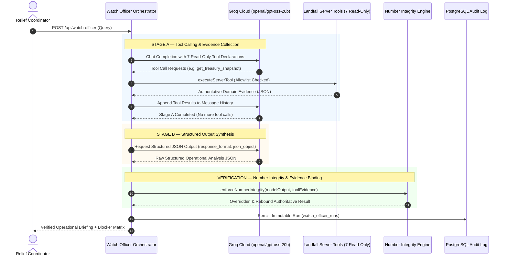

# LANDFALL M6 — GROQ FREE PLAN AI PROVIDER SPECIFICATION
### Zero-Cost Inference Migration · GPT-OSS 20B · Two-Stage Request Pipeline
### PayPal AI Hackathon 2026 · Landfall v3

---

## 1. Executive Summary & Zero-Cost Migration Invariant

To ensure that Landfall's open-source anticipatory relief platform never incurs cloud AI inference costs, the **Watch Officer AI Copilot** has been migrated from its initial OpenAI provider to **Groq Cloud's Free Plan**.

### Fundamental Zero-Cost Policy
> **Strict Financial Constraint: Zero Dollars on AI Inference.**
> Landfall operates entirely within Groq's Free Plan using the open-weights `openai/gpt-oss-20b` model. The system enforces a hardcoded allowlist containing only `openai/gpt-oss-20b`. All paid model fallbacks (OpenAI GPT-4o, Anthropic Claude, Gemini Pro, Cerebras, OpenRouter) have been permanently removed.

---

## 2. Provider & Model Configuration

| Parameter | Specification | Enforcement Mechanism |
|---|---|---|
| **Provider** | Groq Cloud | `https://api.groq.com/openai/v1` via official `groq-sdk` |
| **Billing Plan** | **Free Plan ONLY** | Hardcoded client settings; no automatic Developer upgrade |
| **Model** | `openai/gpt-oss-20b` | Strictly validated by `validateModelName()`; rejects all other models |
| **Authentication** | `GROQ_API_KEY` | Server-side environment variable only; never exposed client-side |
| **Max Tokens (Stage A)** | 1,024 tokens | Bounded token envelope for tool calls |
| **Max Tokens (Stage B)** | 4,096 tokens | Bounded token envelope for structured synthesis |
| **Temperature** | 0.1 | Low entropy for deterministic operational reasoning |
| **Retries** | 0 | No uncontrolled retry loops against rate limits |

### Validation Rule
```typescript
export const GROQ_FREE_MODEL = "openai/gpt-oss-20b" as const;
export const FREE_MODEL_ALLOWLIST = [GROQ_FREE_MODEL] as const;

export function validateModelName(modelName?: string): string {
  const selected = modelName || process.env.WATCH_OFFICER_MODEL || GROQ_FREE_MODEL;
  if (!FREE_MODEL_ALLOWLIST.includes(selected as any)) {
    throw new Error(
      `[ZERO_COST_VIOLATION] Model '${selected}' is not permitted. Only free-tier model '${GROQ_FREE_MODEL}' is allowed.`
    );
  }
  return selected;
}
```

---

## 3. Two-Stage Request Pipeline

Groq's official API documentation specifies that **tool calling and structured outputs cannot currently be executed in the same request**. The Watch Officer implements a structured two-stage request pipeline to respect this provider constraint while upholding strict data integrity:



### Stage A: Tool Calling through Server Allowlist
1. The user query is encapsulated in untrusted demarcations:
   ```
   <<< UNTRUSTED_USER_QUERY >>>
   ${query}
   <<< END_UNTRUSTED_USER_QUERY >>>
   ```
2. Groq is provided with declarations for the 7 Landfall domain tools:
   - `get_disaster_context`
   - `get_exposure_summary`
   - `get_treasury_snapshot`
   - `get_policy_evaluation`
   - `get_payout_status`
   - `get_reconciliation_status`
   - `compare_response_scenarios`
3. If Groq requests an unauthorized tool (e.g. `send_payout` or `charge_vault`), the server rejects it with a security violation.
4. Tool results are appended as `{ role: "tool", content: JSON.stringify(result) }`.
5. Max tool iterations: capped at 5 loops to prevent infinite cycles.

### Stage B: Structured Output Synthesis
1. Once all tool evidence is collected, the orchestrator requests the final response using `response_format: { type: "json_object" }`.
2. The raw response is safely parsed and validated against `WatchOfficerResponseSchema`.
3. The parsed analysis is passed to `enforceNumberIntegrity()`, which overrides any hallucinated numbers and rebinds all factual claims to verified evidence IDs.

---

## 4. Execution Modes: Live vs Offline vs Mocked

To maintain absolute transparency in production and test environments, the system distinguishes three operating modes:

### 1. Real Groq Inference (`groq/openai/gpt-oss-20b`)
- **Condition:** `GROQ_API_KEY` is present in server environment, `useLiveModel: true`.
- **Execution:** Calls Groq's official API at `https://api.groq.com/openai/v1`.
- **Output:** Genuine language-model reasoning grounded in server evidence, with numbers verified and overridden by `enforceNumberIntegrity()`.
- **Cost:** **$0.00** (Free Plan).

### 2. Deterministic Offline Fallback (`OFFLINE_FALLBACK`)
- **Condition:** `GROQ_API_KEY` is missing, `useLiveModel: false`, or Groq returns HTTP 429 / 503 / timeout.
- **Execution:** Pure TypeScript template synthesizer (`generateDeterministicTemplateAnalysis`).
- **Output:** 100% deterministic, evidence-grounded response conforming to `WatchOfficerResponseSchema`.
- **Badge / Label:** Labeled as `offline-deterministic-synthesizer (OFFLINE_FALLBACK)` or `openai/gpt-oss-20b (OFFLINE_FALLBACK)`; injects `[OFFLINE_FALLBACK]` warning banner.
- **Cost:** **$0.00** (Runs locally on CPU).

### 3. Mocked Test Responses (Automated CI)
- **Condition:** Running automated test suites (`tests/ai/groq-provider.test.ts`).
- **Execution:** Uses Vitest dependency injection (`groqClient` parameter) to simulate Groq API responses, HTTP 429 rate limits, and provider timeouts.
- **Cost:** **$0.00** (Zero network requests made in CI).

---

## 5. Rate-Limit & Failure Handling (HTTP 429)

Groq's Free Plan enforces requests-per-minute (RPM) and tokens-per-minute (TPM) caps. When a quota is exhausted or HTTP 429 is received:

1. **Immediate Halt:** Remote inference stops immediately. Uncontrolled retry loops are prohibited.
2. **No Paid Escalation:** The system never escalates to a paid provider or Developer tier.
3. **Graceful Degradation:** The orchestrator seamlessly serves the deterministic offline analysis.
4. **Transparent Warning:** The response payload includes:
   `[OFFLINE_FALLBACK] Groq Free Plan inference unavailable (RATE_LIMITED). Operating via deterministic offline engine.`
5. **Dignity & Continuity:** Relief coordinators never experience downtime during a disaster emergency.

