# Product overview

> What Landfall does, screen by screen, and what is real versus simulated behind each one. Every statement was checked against the code at commit `f8f21a7` or against the running application; screenshots are in [`docs/assets/screenshots/`](assets/screenshots/). Read [LIMITATIONS.md](LIMITATIONS.md) alongside this page. For how it is built, see [ARCHITECTURE.md](ARCHITECTURE.md).

## The problem

When a storm hits, a community relief fund can send money to affected families in hours. Then a harder question starts: **did it arrive?**

A payment passes through several different facts, and most tools collapse them into one green tick:

| Stage | Plain meaning | Who says so |
|---|---|---|
| Payment **initiated** | The fund decided to pay and two people agreed | Landfall |
| Payment **submitted** | The instruction was sent to PayPal | Landfall |
| Payment **succeeded** | PayPal says it credited the recipient's PayPal account | PayPal |
| Payment **claimed** | A recipient who had no PayPal account has signed up and taken it (otherwise it sits "unclaimed" and PayPal returns it after 30 days) | PayPal |
| Recipient **confirmed** | The household itself says it received the money and can use it | The household |
| Reconciliation **completed** | The ledger and PayPal's own balance agree, with any difference explained | Landfall, from both sides |

PayPal reporting a batch as `SUCCESS` did not mean every household was credited: in the project's recorded Sandbox batch, one of five items had succeeded while three sat unclaimed ([PAYPAL_INTEGRATION.md §8](PAYPAL_INTEGRATION.md#8-evidence-register-owner-provided-not-re-executed)). Landfall's purpose is to keep these stages apart and to make every payment end in an answer: *delivered, confirmed, returned, or needs a person*.

## How the screens follow a payment

The sidebar order is the order a coordinator lives through a storm ([`components/layout/flow.ts`](../components/layout/flow.ts) drives the sidebar, the "next step" footer and the guided tour from one list).

| Stage | Question it answers | Screens |
|---|---|---|
| Home | Where does everything stand? | Command Center |
| Before landfall | Who is in the storm's path? | Storm Desk · Storm Drill |
| Decide and pay | Who gets paid, and who agreed? | Guided Response · Approvals · Households |
| Did it land? | Did the money reach each family? | Payments · AI Watch Officer · Analytics Studio |

Public pages: the landing page (with the live globe, giving, safety and a one-button **guided tour**), `/judges` (test card), `/validate` (stakeholder feedback), `/signin`, and the resident pages `/r/enroll` and `/r/complaints`.

## A. Public site

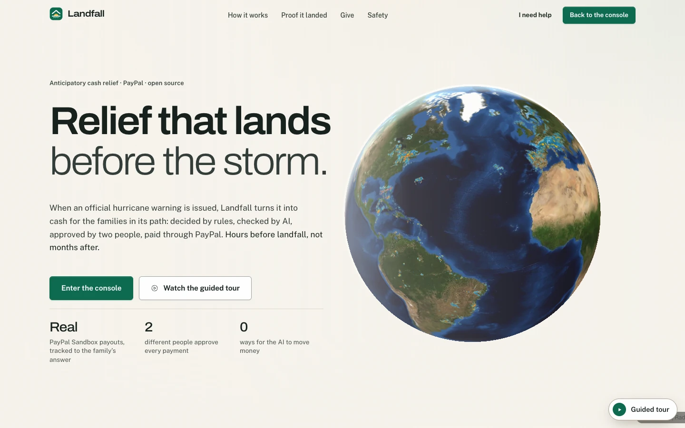

The landing page explains the purpose, embeds the live Storm Desk globe, and offers giving: a PayPal Smart Buttons one-time donation and a $25 monthly sustainer subscription (both Sandbox: **no real money**; use the Sandbox test card on `/judges`). A Safety section describes the guardrails, and a one-button guided tour walks a visitor through every console screen top to bottom (the tour never triggers a payout, `tests/tour/safety.test.ts`). The "Relief board" preview card on the landing page is **static**, drawn from the replay dataset, not live data ([LIMITATIONS.md](LIMITATIONS.md)).

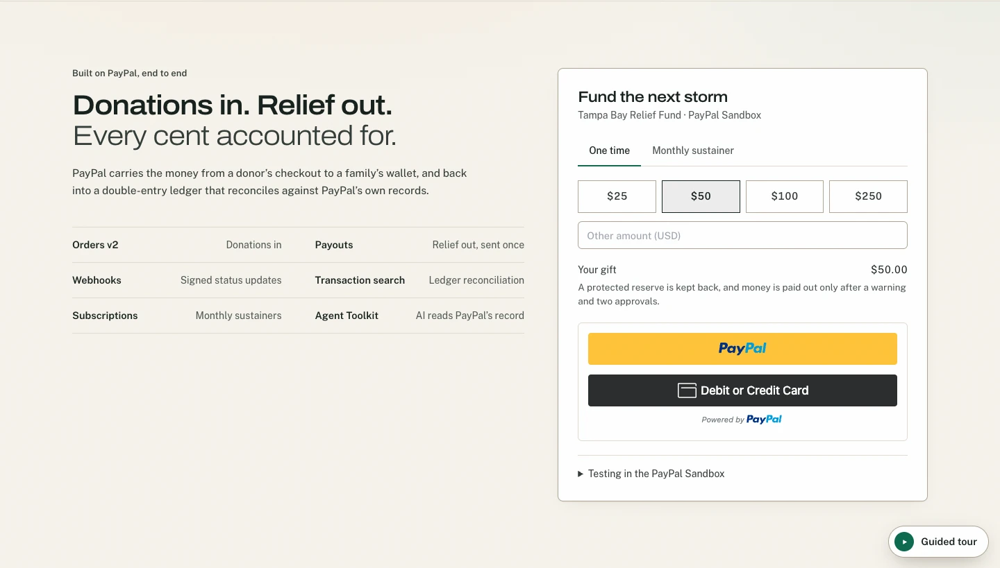

## B. Command Center

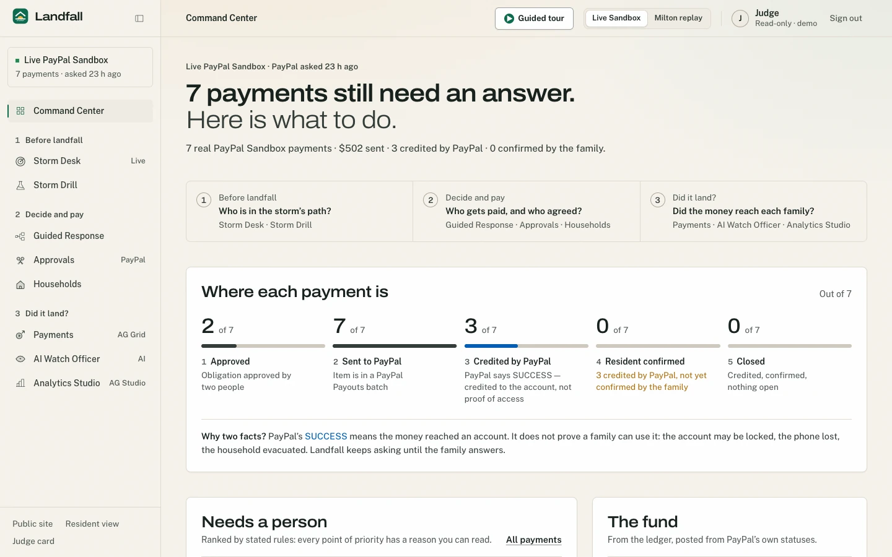

`/console/war-room`: the console's home, built around one question: *what needs a person right now?* Its headline either says "Every payment has an answer." or counts the payments still waiting for one. Below it: a three-stage response path (before landfall, decide and pay, did it land), a **Needs a person** list where each payment has one clear next action and resident reports ("I received it" / "I can't access it") are surfaced, and **The fund** panel (an AG Chart donut of available, reserve and sent money). The case data comes from the selected source: **live Sandbox records** when real Sandbox payments are stored, otherwise the **Milton replay**; the page says which and when PayPal was last asked. The treasury waterfall, money-path explorer, settlement-integrity bridge and impact evidence live on the Payments page's **Money trail** tab, not here.

## C. Sentinel Storm Atlas (Storm Desk)

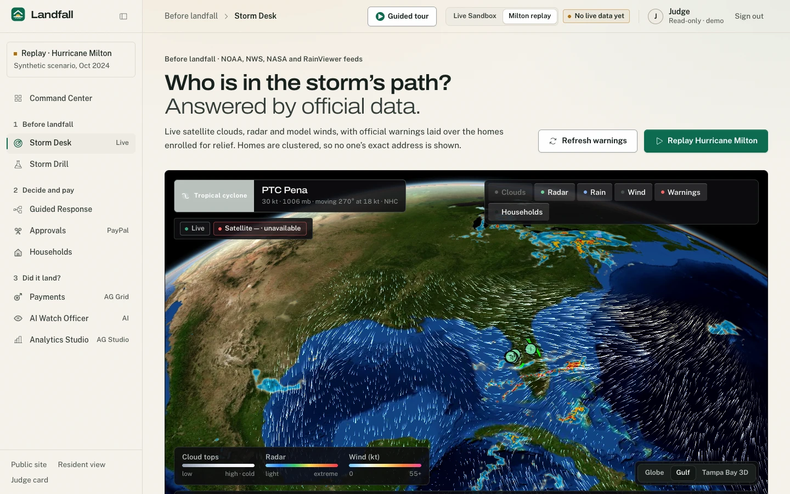

`/console/sentinel`: a MapLibre/WebGL globe with official data: NWS alerts and polygons, NHC storm products, NASA GIBS satellite imagery, RainViewer radar and an Open-Meteo wind/rain forecast, over privacy-preserving clusters of enrolled households (computed from the **synthetic** household fixtures). Household exposure is decided deterministically by point-in-polygon (Turf.js), never by AI. Every layer reports `LIVE`, `STALE`, `REPLAY` or `ERROR`. Observed while writing this documentation: NASA GIBS returned HTTP 504 and Open-Meteo returned 429 to the deployment, and the desk said the layers were unavailable rather than failing ([LIMITATIONS.md](LIMITATIONS.md)). The screenshot above was captured against a local build where the wind layer worked; it still shows the desk's red "Satellite — unavailable" label, which is the real state of that feed at the time.

## D. Storm Drill

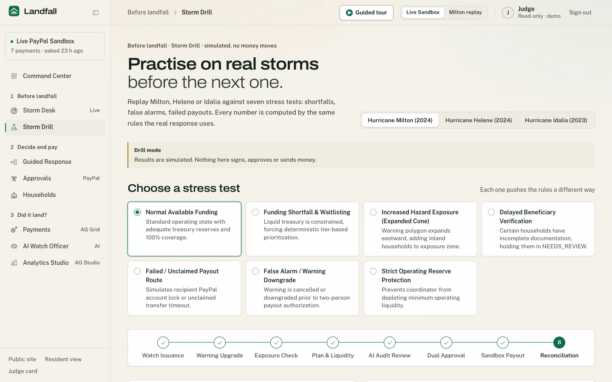

`/console/rehearsal`: replay a response to a past hurricane (Milton 2024, Helene 2024, Idalia 2023 and others in `lib/rehearsal/lab.ts`) under chosen funding scenarios, to see whether the fund could have afforded it, how many households were in the polygon and where the plan would have stalled. It is a simulation: no PayPal call, no state, labelled `HISTORICAL_REPLAY` on every response (`/api/rehearsal`).

## Guided Response

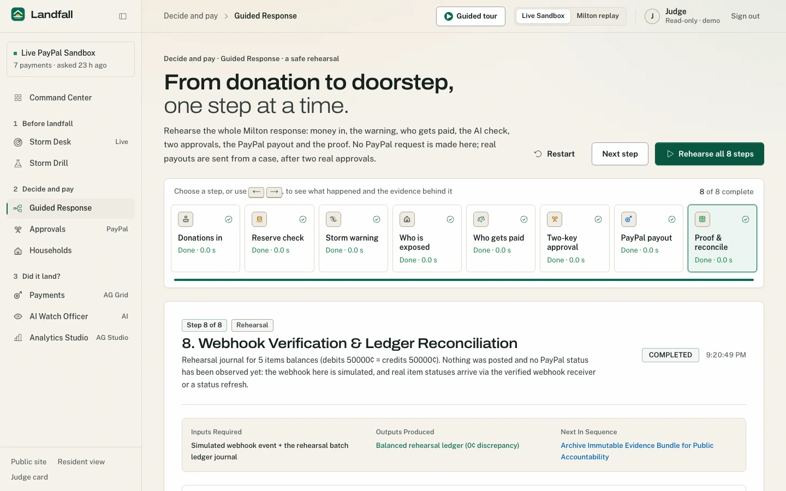

`/console/golden-flow`: eight steps from warning to payout rehearsed end to end with a **simulated PayPal sender** (`/api/workflow/golden`): it makes no PayPal request and persists nothing. Real payouts go only through two server-verified approvals (below).

## E. Recipient system (Households)

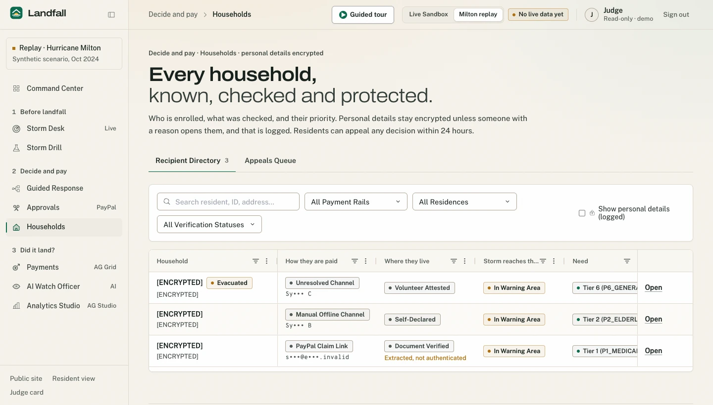

`/console/recipients`: an AG Grid of enrolled households with four independent verification chips (payment channel, recipient path, evidence level, exposure), appeals, and per-household detail. Enrolment is by self-service, volunteer-assisted or post-event; each consent (terms, payment routing, location, emergency disclosure) is recorded separately with its method. Missing paperwork never lowers priority or amount; it routes to a human reviewer. Name and address are encrypted; receivers are masked on screen ([DATA_MODEL.md §5](DATA_MODEL.md#5-sensitive-fields) for the honest picture). *The screenshot shows three clearly synthetic households I enrolled in a disposable local database; the live deployment holds no real households.*

## F. Funding and treasury

Donations (one-time and monthly) are recorded from PayPal's own answers: the capture route refuses anything PayPal did not complete, and the ledger is posted on the verified webhook. The treasury waterfall shows what is free to send after the protected reserve, fees reserved and money already committed ([FINANCIAL_LEDGER.md §6](FINANCIAL_LEDGER.md#6-treasury-formulas)). "Storm pledges" (contingent donations) exist as API endpoints and tables only; nothing charges them ([LIMITATIONS.md](LIMITATIONS.md)).

## G. PayPal integration

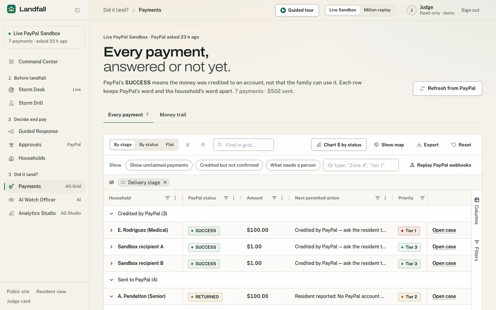

Orders v2 and Smart Buttons (donations), Subscriptions (sustainers), Payouts v1 (relief), Webhooks, Reporting (balances and transactions), the read-only Agent Toolkit, and an identity-check prototype using Log in with PayPal. **Sandbox only.** Detail, status table and owner-provided evidence: [PAYPAL_INTEGRATION.md](PAYPAL_INTEGRATION.md).

## H. Ledger and reconciliation

A double-entry ledger (balanced entries, deterministic ids so replay is a no-op) records money by what it *is*, including holding unclaimed payouts in their own account. Reconciliation compares the ledger with PayPal's reporting balance and classifies the difference (`IN_SYNC`, `EXPLAINED_DIFFERENCE`, `TIMING_DIFFERENCE`, `MISMATCH_ALERT`, `UNVERIFIED`). It is on the Payments page's **Money trail** tab. *I did not include a screenshot of that tab: it showed layout defects at 1440 px and is listed as a known issue.* Detail: [FINANCIAL_LEDGER.md](FINANCIAL_LEDGER.md).

## I. AI Watch Officer

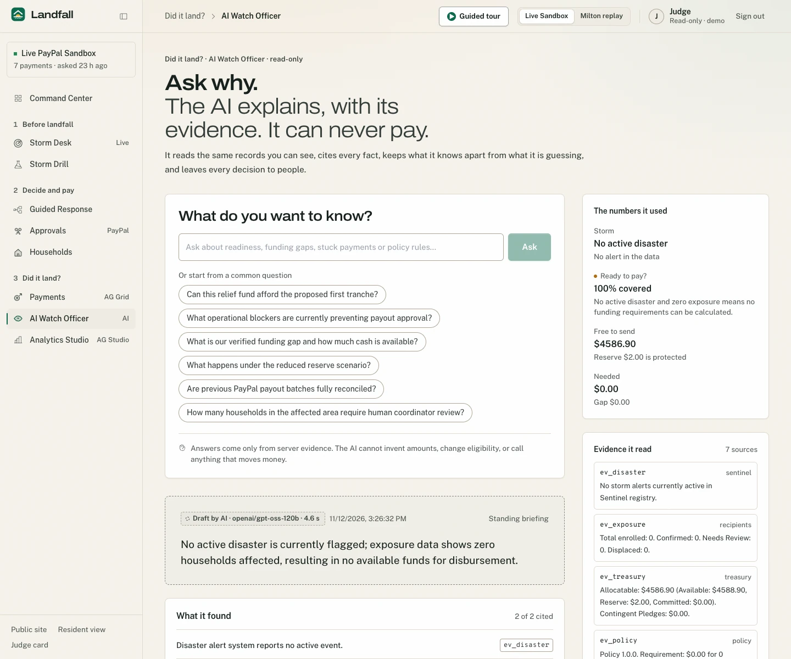

`/console/watch-officer`: ask "can we afford the first tranche?" and get a briefing built from seven read-only tools whose results become cited evidence. The server then **overrides** the model's readiness state and replaces its figures with the ledger's, dropping or restating anything the evidence does not support. If Groq is unavailable it says so and shows a labelled deterministic answer. It cannot move money ([AI_ARCHITECTURE.md §3.3](AI_ARCHITECTURE.md#33-ai-watch-officer-libaiwatch-officer-post-apiwatch-officer)).

## J. AI Case Officer

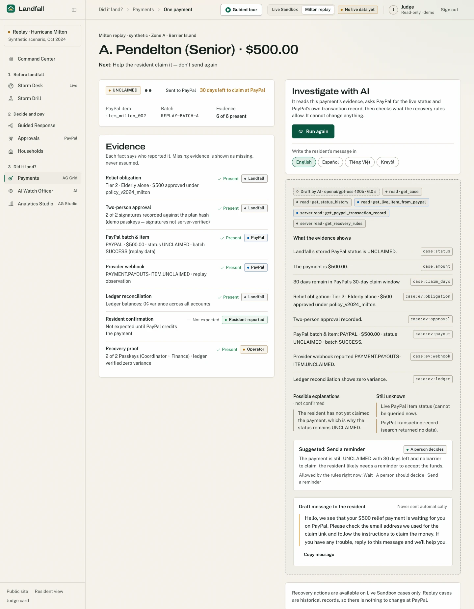

On a payment's detail page (`/console/cases/<ref>`), **Investigate** runs five read-only tools (stored case, status history, one live PayPal item read, PayPal's own transaction record via the Agent Toolkit, the deterministic recovery rules) and returns evidence-cited facts, hypotheses, unknowns, a recommended action clamped to what the rules allow, and a draft resident message in four languages. Facts without evidence are dropped and counted. *This screenshot shows the Milton replay case ("replay" is stated on the page), captured on a local build.*

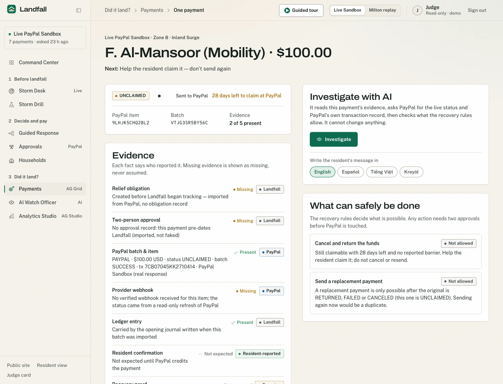

## K. AG Grid, AG Charts and AG Studio

The **Payments** page (`CaseGrid`) and **Households** page (`HouseholdGrid`) use AG Grid Enterprise: set filters, row grouping with a group panel, aggregation, master/detail, integrated charts, cell selection, a custom context menu, custom cell renderers and a side bar. The Command Center uses AG Charts. **Analytics Studio** (`/console/studio`) is AG Studio 3.1.0 over a synthetic replay dataset, with a custom Solvency widget and an agent whose model adapter is Landfall's (it can rearrange the board; it cannot move money, [AI_ARCHITECTURE.md §3.6](AI_ARCHITECTURE.md#36-ag-studio-agent-consolestudio-post-apistudio-llm)). AG Grid Enterprise and AG Studio need licence keys supplied through environment variables; this repository contains none, and without a valid key AG's own evaluation notice stays visible (the code never hides it). Whether the live deployment has valid keys is the maintainer's to confirm.

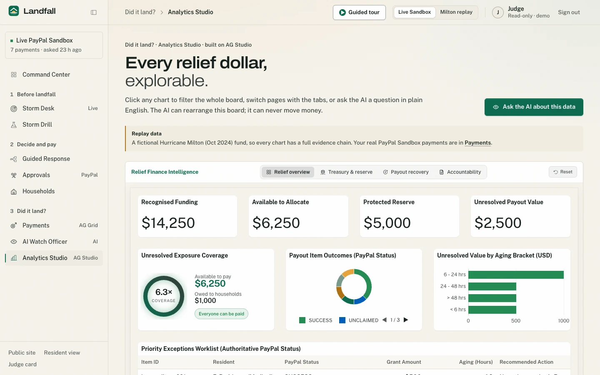

## L. Governance and security

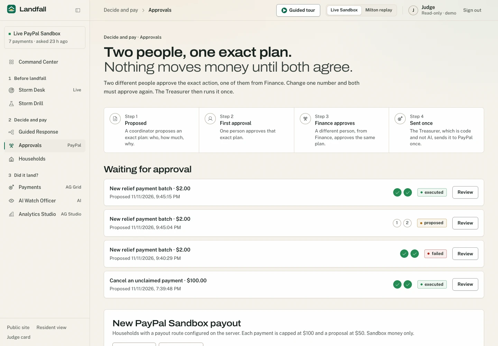

**Approvals** (`/console/proposals`): nothing moves money until two different people approve a stored proposal, one of them Finance; the second approval triggers the Treasurer, the only code allowed to call PayPal's write functions. Approvals use passkeys bound to the exact payload, or, in the Sandbox demo, a labelled demo PIN. Honest status: sign-in on the demonstration is a one-click choice of fictional personas, so **the public demo is not an access-controlled system**; see [SECURITY.md](../SECURITY.md) and [THREAT_MODEL.md](THREAT_MODEL.md).

## M. Resident portal

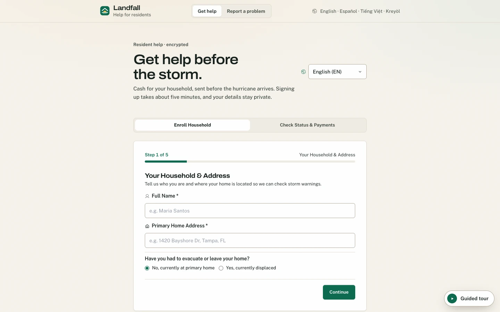

`/r/enroll` has two tabs: **Enroll Household** and **Check Status & Payments**, in English, Spanish, Haitian Creole, Vietnamese and Chinese. A resident enters their case reference and the six-digit code a coordinator gave them (wrong codes lock a household for 15 minutes), sees their payment in plain language, and can report **"I received it"** or **"I can't access it"** with a reason; that report is recorded as recipient-reported evidence and never changes PayPal's status. Residents can also file an appeal or a complaint (`/r/complaints`; complaints are held in memory only, [LIMITATIONS.md](LIMITATIONS.md)). Voice reporting is represented in the data model (a `voice` channel with transcript and translation) but no speech-to-text path is wired in.
