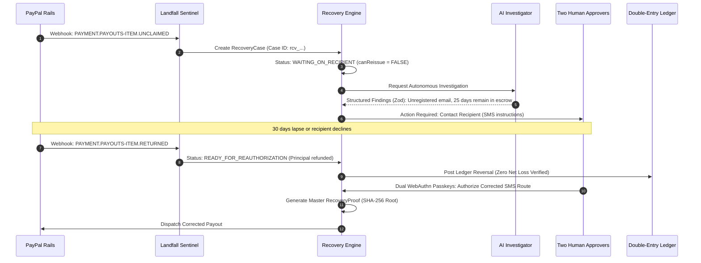

# Proof-Carrying Relief Recovery Workflow & State Architecture

## 1. Executive Summary

In anticipatory disaster relief, moving money quickly is necessary, but **moving money safely and accounting for every payout state without silent failure is essential**.

Traditional payment systems treat payouts as fire-and-forget: once dispatched to an API endpoint, if an email is unclaimed or a receiver account is closed, funds sit in limbo, recipients suffer without aid, or administrators inadvertently double-pay while attempting manual fixes.

Landfall introduces **Proof-Carrying Relief Recovery**: a closed-loop cryptographic architecture connecting:

$$\text{Donor Contribution} \rightarrow \text{Relief Obligation} \rightarrow \text{PayPal Payout Item} \rightarrow \text{Exception Investigation} \rightarrow \text{Authorized Recovery} \rightarrow \text{Master Proof} \rightarrow \text{Reconciliation}$$

Every payment status returned by PayPal's Payouts API has a deterministic operational state, provably safe recommendations, and an immutable SHA-256 certificate of resolution.

---

## 2. The 9 PayPal Payout Item States & Operational Guarantees

PayPal's Payouts v1 API returns nine distinct statuses for individual payout items (`/v1/payments/payouts-item/{payout_item_id}`). Landfall enforces strict behavioral invariants for each:

| Status | PayPal Rail State | Landfall Invariant & Operational Meaning | Permitted Action | Can Reissue Immediately? |
|---|---|---|---|:---:|
| **`SUCCESS`** | Funds credited to recipient PayPal wallet | Disbursement confirmed. Recipient has access to digital cash. Zero further payout action permitted. | `CLOSE_AS_RESOLVED` | ❌ **NO** |
| **`PENDING`** | Queued or processing in PayPal rails | In-flight transaction. Awaiting settlement or network confirmation. | `WAIT_AND_MONITOR` | ❌ **NO** |
| **`UNCLAIMED`** | In PayPal escrow (30-day window) | Recipient does not have an active/confirmed PayPal account. **Funds are held in escrow for 30 days**. Reissuing would cause **double payment**. | `CONTACT_RECIPIENT` (SMS guidance on claiming funds) | ❌ **STRICTLY NO** |
| **`RETURNED`** | 30-day window expired / rejected | Recipient never claimed funds within 30 days. PayPal has credited the principal back to Landfall's balance. Zero net loss. | `PREPARE_CORRECTED_RETRY` (Requires dual passkey reauthorization) | ❌ **NO (Requires Sign-off)** |
| **`FAILED`** | Terminal delivery failure | Payer/receiver country restriction, account closed, or invalid identifier. Principal never debited. Safe to reallocate under new dual authorization. | `PREPARE_NEW_APPROVED_PAYOUT` | ❌ **NO (Requires Sign-off)** |
| **`ONHOLD`** | Risk / compliance hold | PayPal risk management or compliance review active. Escalation to merchant support required. | `ESCALATE_TO_PAYPAL_OR_OPERATOR` | ❌ **NO** |
| **`BLOCKED`** | Regulatory / policy block | Payout blocked by policy or regulatory review. Do not attempt programmatic retry. | `ESCALATE_TO_PAYPAL_OR_OPERATOR` | ❌ **NO** |
| **`REFUNDED`** | Post-settlement refund | Payout was refunded back to sender post-settlement. Requires ledger reversal transaction. | `PREPARE_CORRECTED_RETRY` | ❌ **NO (Requires Sign-off)** |
| **`REVERSED`** | Post-settlement reversal | Payout was reversed. Requires ledger audit adjustment before preparing resolution. | `PREPARE_CORRECTED_RETRY` | ❌ **NO (Requires Sign-off)** |

---

## 3. Cryptographic Recovery Proof Architecture

When an anomalous payout state is resolved, Landfall generates an immutable **Proof-Carrying Recovery Certificate** (`RecoveryProof`).

The certificate binds five independent pillars of cryptographically verified evidence:

1. **`obligationHash`**: SHA-256 digest of original household entitlement, target amount, approved plan hash, and dual passkey signatures.
2. **`payoutTraceHash`**: SHA-256 digest of PayPal payout batch ID, item ID, transaction ID, rail status, amounts, and fees.
3. **`webhookVerificationHash`**: SHA-256 digest of verified PayPal webhook events confirming the status transition.
4. **`ledgerTraceHash`**: SHA-256 digest of double-entry ledger journals and reconciliation entries.
5. **`actionAuthorizationHash`**: SHA-256 digest of human coordinator and fiduciary WebAuthn passkey signatures authorizing the specific recovery action.

### Master Root Hash Formula:

$$\text{masterProofHash} = \text{SHA-256}\Big(\text{obligationHash} \,\|\, \text{payoutTraceHash} \,\|\, \text{webhookVerificationHash} \,\|\, \text{ledgerTraceHash} \,\|\, \text{actionAuthorizationHash}\Big)$$

Any modification to amounts, recipient addresses, transaction records, or approval credentials immediately breaks the cryptographic proof chain, preventing unauthorized ledger adjustments or covert double disbursements.

---

## 4. End-to-End Recovery Flow

