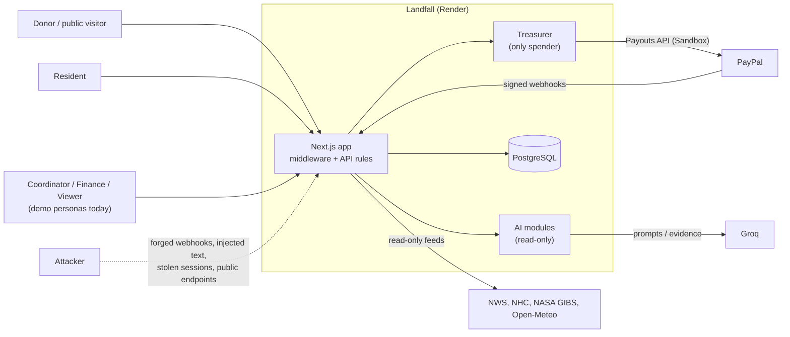

# Threat model

> Scope: the Landfall web application and its integrations (PayPal Sandbox, Groq, NWS/NHC/NASA/Open-Meteo, PostgreSQL on Render) as implemented at commit `f8f21a7`. This is the project's **own analysis**, not an external assessment, and it is limited to what was read in the code and observed in the tests. The product runs on Sandbox with synthetic data, so many "impacts" below describe what *would* happen with real funds or real beneficiaries. Companion pages: [SECURITY.md](../SECURITY.md), [ARCHITECTURE.md](ARCHITECTURE.md), [FINANCIAL_LEDGER.md](FINANCIAL_LEDGER.md), [AI_ARCHITECTURE.md](AI_ARCHITECTURE.md), [LIMITATIONS.md](LIMITATIONS.md).

## 1. What is being protected

| Asset | Why it matters |
|---|---|
| Relief funds in the PayPal account | Wrong or duplicate payments are irreversible once claimed |
| The ledger | If it disagrees with PayPal, nobody can say how much is left or what was paid |
| Household identity, address, location, payment receiver | Disaster survivors; exposure causes real harm |
| Approval authority (two-person rule) | The control that stands between a mistake and a payout |
| Donor identity | Payer email, saved payment methods |
| Public trust in "every payment has an answer" | Honest status is the product |

## 2. Trust boundaries and actors

Untrusted: every request body and query string, resident free text, PayPal field content until a webhook is verified, model output, the browser's claims about identity or amounts. Trusted *with limits*: PayPal (after signature verification) and the database contents.

## 3. Threats

Format: **Scenario · Impact · Mitigation · Evidence · Residual risk.**

### T1 Forged webhook

* **Scenario**: someone POSTs a fake `PAYMENT.PAYOUTS-ITEM.SUCCEEDED` (or `CAPTURE.COMPLETED`) to `/api/paypal/webhook` to make the ledger show money received or a payout settled.
* **Impact**: ledger and case status diverge from PayPal; a false "paid" outcome.
* **Mitigation**: the route requires the PayPal signature headers and verifies them with PayPal's `verify-webhook-signature` API against the configured `PAYPAL_WEBHOOK_ID`; without the id configured it answers 503; a failed or missing signature answers 401. Unverified events are stored with `verified=false` and change nothing. A payout event is additionally applied only through `applyItemObservation`, which compares the amount and currency to what was approved.
* **Evidence**: `tests/paypal/webhook-gate.test.ts`, `webhooks.test.ts`, `webhook-payouts.test.ts`; route source `app/api/paypal/webhook/route.ts`.
* **Residual**: verification depends on PayPal's API being reachable (an outage fails closed: events are rejected and rely on the refresh path); the check does not enforce freshness of `transmission_time` (see T2).

### T2 Webhook replay

* **Scenario**: a genuine, validly signed event is captured and re-sent later, or PayPal re-delivers.
* **Impact**: double-counting money or reverting a status.
* **Mitigation**: `webhook_events.paypal_event_id` is the primary key, so a second delivery is recognised and answered "duplicate" without reprocessing; the ledger uses deterministic transaction ids; item observations are idempotent and ordered by PayPal's `create_time` with a precedence guard.
* **Evidence**: `tests/payouts/store.test.ts` (replay, concurrency, stale-event cases), `tests/ledger/ledger.test.ts`.
* **Residual**: an old signed event that Landfall never received could still be accepted once; the precedence guard and idempotent ledger limit what it can change, and nothing enforces a maximum event age.

### T3 Duplicate payout

* **Scenario**: a double click, two approvers racing, a retry after a timeout, or a coordinator re-proposing the same payment.
* **Impact**: a household paid twice; funds lost.
* **Mitigation**: unique idempotency key on proposals; unique approval per person; atomic `APPROVED → EXECUTING`; outbox record before the network call; `sender_batch_id` reused as the `PayPal-Request-Id`; payment-creating POSTs without a key are never retried; the Treasurer refuses a household with a payment already in `SUBMITTED/PENDING/UNCLAIMED/ONHOLD/BLOCKED`; an unknown outcome ends as `FAILED` with "do not resend".
* **Evidence**: `tests/proposals/flow.test.ts`, `tests/treasurer/*`, `tests/paypal/client-resilience.test.ts`; owner evidence of a repeated attempt returning `409 duplicate_blocked` ([PAYPAL_INTEGRATION.md §8](PAYPAL_INTEGRATION.md#8-evidence-register-owner-provided-not-re-executed)).
* **Residual**: two *different* proposals for the same household approved at nearly the same instant depend on the in-flight check reading committed state; the code reads the stored records at execution time, which narrows but is not formally proven to exclude that race. Households outside Landfall's records are not known to it.

### T4 Out-of-order events

* **Scenario**: `SUCCESS` arrives before `PENDING`, or a stale `FAILED` after `SUCCESS`.
* **Impact**: wrong status, wrong ledger position.
* **Mitigation**: status precedence (never downgrade `SUCCESS`, never revive a failure), `STALE_EVENT` by provider time, positions posted only on confirmed transitions, row lock per item.
* **Evidence**: `tests/payouts/status.test.ts`, `store.test.ts` ([FINANCIAL_LEDGER.md §5](FINANCIAL_LEDGER.md#5-out-of-order-duplicate-unknown-and-mismatched-events)).
* **Residual**: statuses PayPal adds in the future are flagged as unknown and need a code change.

### T5 Amount or currency mismatch

* **Scenario**: an event, a tampered proposal or a PayPal-side adjustment carries a different amount or a non-USD currency than approved.
* **Impact**: ledger overstates or understates what moved.
* **Mitigation**: `AMOUNT_MISMATCH` and `CURRENCY_NOT_USD` are flagged, audited and **post nothing**; the approved payload is hashed and re-checked before execution (`PAYLOAD_CHANGED`); caps per item and per proposal; reconciliation reports "Amount mismatch" instead of matching on id alone.
* **Evidence**: `tests/payouts/store.test.ts` ("amount or currency that disagrees … posts NOTHING"), `tests/treasury/reconciliation.test.ts`.
* **Residual**: flagged items need a person to resolve them.

### T6 Prompt injection

* **Scenario**: a user (or text inside a resident report, alert or PayPal field) tells an AI to ignore its rules, approve a payout, change a priority or reveal personal data.
* **Impact if it worked**: misleading advice shown to a coordinator. It *cannot* move money by design (T7).
* **Mitigation**: layered input screening (regex, Prompt Guard 2, safeguard model with a written policy); deterministic refusal of money-moving requests before any model; tool results treated as evidence; answers post-checked against evidence (number integrity, cited facts, clamped action); read-only tool sets.
* **Evidence**: `tests/ai/safety-guard.test.ts`, `tests/security/red_team_adversarial.test.ts`, `tests/ai/studio-agent-security.test.ts`, `tests/ai/watch-officer-money.test.ts`.
* **Residual**: screening is probabilistic and **fails open** when the model layers are unreachable; a successful injection could still produce a misleading explanation that a human must judge. No external red-team has been run.

### T7 AI tool misuse

* **Scenario**: a model calls (or is tricked into calling) a tool that spends, approves or edits records.
* **Impact**: unauthorised money movement or record change.
* **Mitigation**: no such tool exists in any AI tool set; tool names are allow-listed; the PayPal write functions are importable only from `lib/treasurer/`; the Studio gateway returns tool calls without executing them and the browser tools edit only the dashboard; the Treasurer requires two human approvals that no AI output can supply.
* **Evidence**: `tests/arch/boundary.test.ts`; `lib/ai/watch-officer/groq-client.ts` (`READ_ONLY_TOOL_ALLOWLIST`); [AI_ARCHITECTURE.md](AI_ARCHITECTURE.md).
* **Residual**: the boundary test checks imports statically; a future change that adds a write tool would need review.

### T8 Privilege escalation

* **Scenario**: a viewer or resident reaches staff actions, a resident reaches another household, or someone approves their own proposal.
* **Impact**: unauthorised proposal or approval; privacy breach.
* **Mitigation**: default-deny middleware with one access table plus per-route checks; approver identity from the signed session; one person cannot approve the same proposal twice (unique constraint) and the two approvals must include a Finance approver; residents are confined to their household and unknown/foreign references give the same 404; cross-site writes are blocked.
* **Evidence**: `tests/security/access-matrix.test.ts`, `tests/proposals/approvals.test.ts`, `tests/security/resident-code.test.ts`.
* **Residual (real gaps)**: the `viewer` role can POST appeals and reconfirmations; **anyone can obtain a coordinator or finance session through the public demo sign-in** (T9, [SECURITY.md](../SECURITY.md#authentication-today-is-demo-only)).

### T9 Compromised or abusable credentials

* **Scenario**: a stolen session cookie, a leaked secret, or, on the demonstration deployment, the *intended* open persona sign-in and published demo PIN.
* **Impact**: on the demo, a visitor can propose and approve Sandbox payouts within the caps; with leaked `SESSION_SECRET` anyone can mint any session and resident code; leaked `PAYPAL_CLIENT_SECRET` allows direct PayPal calls.
* **Mitigation**: HttpOnly/Secure/SameSite cookie, 8-hour life; demo PIN refused for `PAYPAL_ENV=live`; passkeys supported; PayPal credentials are Sandbox only; caps ($100 per item, $50 per proposal as deployed); household routes server-side; secrets are environment variables, not in the repository.
* **Evidence**: `tests/security/session.test.ts`, `demo-key.test.ts`, `passkeys.test.ts`.
* **Residual**: **high on the demo by design**, unacceptable for production. No account system, no MFA for operator login, no session revocation list (a cookie stays valid until it expires), no secret-rotation procedure beyond changing the variable.

### T10 Unauthorised PII access

* **Scenario**: reading household names, addresses, receivers or coordinates through the API, the database or the AI.
* **Impact**: harm to survivors.
* **Mitigation**: name and address encrypted (AES-256-GCM); API responses mask receivers and round coordinates; decryption only when a server operator enables it, and each decrypting view is logged; audit payloads redacted; AI evidence is aggregate or per-payment, Studio data synthetic; resident endpoints return 404 for foreign references.
* **Evidence**: `tests/security/encryption.test.ts`, `audit-redact.test.ts`.
* **Residual (real gaps)**: the encryption key falls back to a constant in the source when `PII_ENCRYPTION_KEY` is unset (it is not set in `render.yaml`); receivers and coordinates are stored in clear text; there is no row-level security and one database credential; the PII access log is not tamper-evident; complaint contact emails sit in process memory.

### T11 Wrong payment routing

* **Scenario**: money sent to the wrong person: a changed receiver, a typo, or an attacker-supplied address.
* **Impact**: irreversible loss to the wrong party.
* **Mitigation**: receivers never come from a request: payout routes are resolved server-side (`SANDBOX_RECEIVERS` keyed by household) and never returned by any API; the approved payload hash covers the plan; a household without a route is refused (`NO_PAYOUT_ROUTE`); items to MANUAL channels are not sent through PayPal; email-claim recipients who have no account produce `UNCLAIMED` rather than a guess.
* **Evidence**: `tests/treasurer/*`, `tests/proposals/*` (route and payload checks).
* **Residual**: the receiver list is a deployment setting that an operator with environment access controls; email verification of household-supplied PayPal addresses cannot complete outside development because no email is sent ([LIMITATIONS.md](LIMITATIONS.md)); Sandbox only.

### T12 Reserve or treasury manipulation

* **Scenario**: spending the protected reserve, double-counting committed money, or fabricating balance.
* **Impact**: the fund promises more than it has.
* **Mitigation**: `allocatable = max(0, available − reserve − fees reserved − committed)`; the Treasurer re-checks funds with the reserve intact at execution; ledger entries are balanced and idempotent; reconciliation compares the ledger with PayPal's reporting balance and flags differences; the emergency stop (`EMERGENCY_STOP=true`) blocks execution; the Watch Officer's readiness figure is overridden by the deterministic result.
* **Evidence**: `tests/ledger/financial_integrity.test.ts`, `tests/treasury/*`.
* **Residual**: two treasury computations exist (ledger waterfall and live-treasury reading) and can disagree ([FINANCIAL_LEDGER.md §6](FINANCIAL_LEDGER.md#two-treasury-computations-a-known-inconsistency)); the Watch Officer's readiness check uses fixed fee assumptions; the reserve rule is application logic, not a database constraint.

### T13 Database failure or loss

* **Scenario**: the database is down, corrupted or restored from an older state.
* **Impact**: lost status history or ledger entries; duplicate sends after a restore.
* **Mitigation**: writes that precede a payout (outbox) and idempotency keys make a retry safe; PayPal remains the source of truth and the refresh path can re-read batches Landfall recorded; ledger transaction ids are deterministic so replay is a no-op.
* **Evidence**: tests listed under T3 and T4; `lib/payouts/refresh.ts`.
* **Residual**: **no backup or restore procedure is documented or tested**; the Render free-plan database is not intended for production use and may expire; there are no migrations, so recovery means re-applying the schema and re-importing from PayPal for the batches known to it.

### T14 Provider outage or degradation

* **Scenario**: PayPal, Groq or a weather source is unavailable or slow.
* **Impact**: no payouts, missing AI, stale map.
* **Mitigation**: PayPal calls fail closed (nothing is assumed sent; a failed refresh keeps stored statuses); AI surfaces fall back to labelled deterministic answers; weather states are explicit `LIVE / STALE / REPLAY / ERROR` with a banner; upstream failures do not become red console errors.
* **Evidence**: `tests/paypal/client-resilience.test.ts`, `tests/ai/model-ladder.test.ts`, `groq-retry.test.ts`; observed for this documentation: NASA GIBS satellite imagery returned HTTP 504 and Open-Meteo returned 429 from the deployment's address, and the Storm Desk reported the layers as unavailable instead of failing.
* **Residual**: Groq's free-tier rate limits are the common failure; there is no second model provider; satellite and model-wind layers can be unavailable for hours.

## 4. Abuse of public endpoints (not in the original list, but real)

| Endpoint | Abuse | Present control | Gap |
|---|---|---|---|
| `POST /api/recipients/enroll` | Flooding the database with fake households | 6/min per client address | No CAPTCHA, verification or approval step before a record exists; the in-memory limiter resets on restart |
| `POST /api/subscriptions/cancel`, `/api/pledges/revoke` | Cancelling someone else's subscription or pledge | Rate limit; ids are not guessable by chance | No ownership check |
| `POST /api/donations/orders` | Creating many PayPal orders | 10/min per client | No amount bounds beyond format |
| `GET /api/auth/paypal/callback` | Probing / CSRF-style linking | 20/min | `state` not verified; response carries user details |
| Public weather endpoints | Spending upstream quotas | 60/min per client, cached | A shared upstream IP can still hit provider limits (seen as 429) |

## 5. Assumptions

* PayPal's webhook verification API and its signing keys are trustworthy.
* The hosting platform keeps environment variables secret and serves HTTPS.
* Operators are trustworthy *once authentication exists*; today the demonstration deliberately is not authenticated.
* The database is reachable only by the application.

## 6. What this document is not

It is not a penetration test, a certification, an audit by a third party, or a guarantee. It does not cover the client-side supply chain beyond the dependency list in `package.json`, nor the Render, Groq or PayPal platforms themselves.
